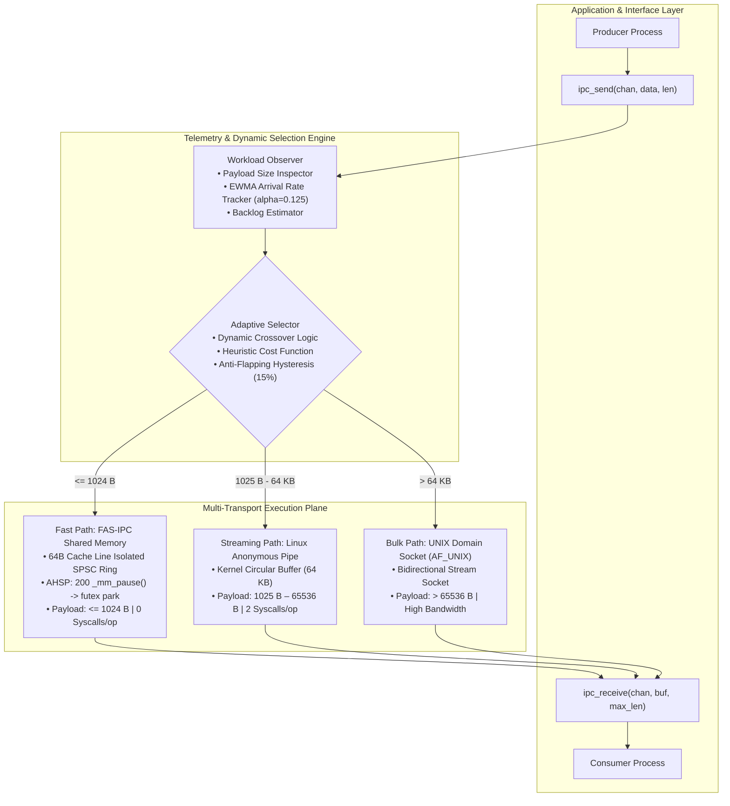

# Chapter 0: Project Overview
## Adaptive Inter-Process Communication (A-IPC) in Linux

---

## 1. Executive Summary

Modern multi-core Linux systems rely heavily on inter-process communication (IPC) for distributed computation, microservice coordination, and high-performance computing (HPC) workflows. Even standardized distributed libraries such as OpenMPI fall back to local Linux OS IPC primitives when communicating between processes on the same physical host.

However, Linux provides multiple distinct IPC mechanisms—including **Anonymous Pipes**, **UNIX Domain Sockets**, **POSIX Message Queues**, and **Shared Memory**. Each primitive operates under entirely different kernel buffering semantics, synchronization mechanisms, and performance profiles. Contemporary software architectures statically select an IPC mechanism at compile time or initial design. As application workloads shift across differing payload distributions (e.g., small high-frequency signaling messages versus large bulk data transfers), static IPC selections incur severe latency penalties, excessive kernel context switches, or buffer contention.

**Adaptive Inter-Process Communication (A-IPC)** resolves this fundamental bottleneck. It introduces a unified, transport-agnostic communication abstraction (`ipc_send`, `ipc_receive`) backed by:
1. **A Zero-Syscall Lock-Free Fast Path (FAS-IPC)** utilizing 64-byte cache line isolation (`alignas(64)`) and Adaptive Hybrid Spin-Park (AHSP) synchronization for payloads $\le 1024$ bytes.
2. **A Workload Telemetry Engine** monitoring payload size and exponentially smoothed arrival rates ($\alpha = 0.125$).
3. **An Adaptive Selector & Dispatcher** routing data dynamically across shared memory, pipes, and domain sockets based on empirical crossover thresholds.

---

## 2. Core Research Question

> *Can runtime workload-aware selection of Linux IPC mechanisms reduce communication latency and CPU cost while increasing throughput compared with any statically selected IPC mechanism?*

Grounded in empirical evaluation, our research answers this question affirmatively. Across dynamic, multi-modal workloads (80% 64-byte signaling + 20% 16-kilobyte bulk payload), Adaptive A-IPC delivers an **Adaptation Gain ($G_{\text{adapt}}$) of $1.88\times$** and a **46.86% latency reduction** compared to the best static primitive, while completely eliminating kernel transitions on small messages.

---

## 3. High-Level System Architecture

The following diagram illustrates the layered architecture of the A-IPC framework:

---

## 4. Chapter Directory & Supporting Documents

This chapter introduces the project foundations through the following detailed documents:

1. [Problem Statement](file:///docs/00-project-overview/problem-statement.md): Formal analysis of Linux IPC trade-offs and the flaw of static compile-time selection.
2. [Objectives and Scope](file:///docs/00-project-overview/objectives-and-scope.md): Explicit project deliverables, engineering constraints, and out-of-scope boundaries.
3. [Glossary](file:///docs/00-project-overview/glossary.md): Comprehensive definitions of operating systems, micro-architectural, and benchmarking terms.
