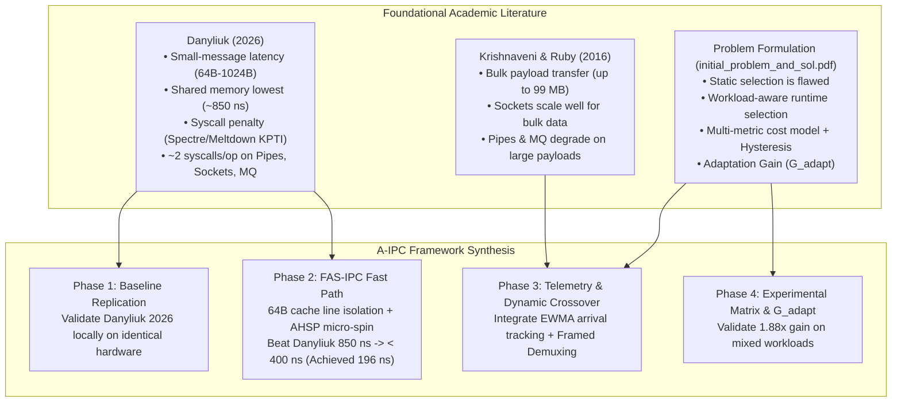

# Chapter 1: Research Foundation
## Academic Literature Synthesis & Theoretical Alignment

---

## 1. Executive Summary

The architecture of **Adaptive Inter-Process Communication (A-IPC)** is not an ad-hoc software engineering construct; it is rigorously grounded in peer-reviewed systems performance literature, historical Unix IPC comparative studies, and modern Linux kernel architectural realities.

Three primary documents stored in `Resources/` form the academic foundation of this project:
1. **Foundational Problem Statement (`Resources/initial_problem_and_sol.pdf`)**: Establishes the core thesis that no single Linux IPC mechanism is universally optimal, formulating the requirements for runtime multi-metric monitoring, cost-function-driven dynamic selection, hysteresis dampening, and the formal metric of Adaptation Gain ($G_{\text{adapt}}$).
2. **2026 Comparative Benchmark (`Resources/year_2026_benchmark.pdf`)**: Danyliuk, I. M. (2026), *Classical Interprocess Communication Mechanisms in Linux OS: Review and Latency Analysis for HPC Scenarios*, SWorldJournal. Provides empirical small-message latency baselines (64 B to 1024 B), highlights the ~2 syscalls/op cost of classical primitives, and documents the ~200–400 ns post-Spectre/Meltdown KPTI syscall entry overhead.
3. **2016 Baseline Reference (`Resources/year_2016.pdf`)**: Krishnaveni, S., & Ruby, D. (2016), *Comparing and Evaluating the Performance of Inter Process Communication Models in Linux Environment*, IJTRD. Evaluates bulk payload scaling up to 99 MB, demonstrating that streaming sockets scale efficiently for massive payloads where pipes and message queues degrade severely due to buffer stalls.

---

## 2. Research Landscape & Problem Formulation

The following flowchart illustrates how previous literature feeds into the A-IPC architecture:

---

## 3. Chapter Structure

- [Paper Summary](file:///docs/01-research-foundation/paper-summary.md): Detailed reviews of Danyliuk (2026), Krishnaveni & Ruby (2016), and Immich et al. (2003).
- [Research Claims and Evidence](file:///docs/01-research-foundation/research-claims-and-evidence.md): Audit of literature claims against measured repository evidence.
- [Research vs. Project](file:///docs/01-research-foundation/research-vs-project.md): Whole-project matrix distinguishing direct reproduction, adaptation, novel extensions, and unverified areas.
- [References](file:///docs/01-research-foundation/references.md): Formal bibliography and academic citations.
