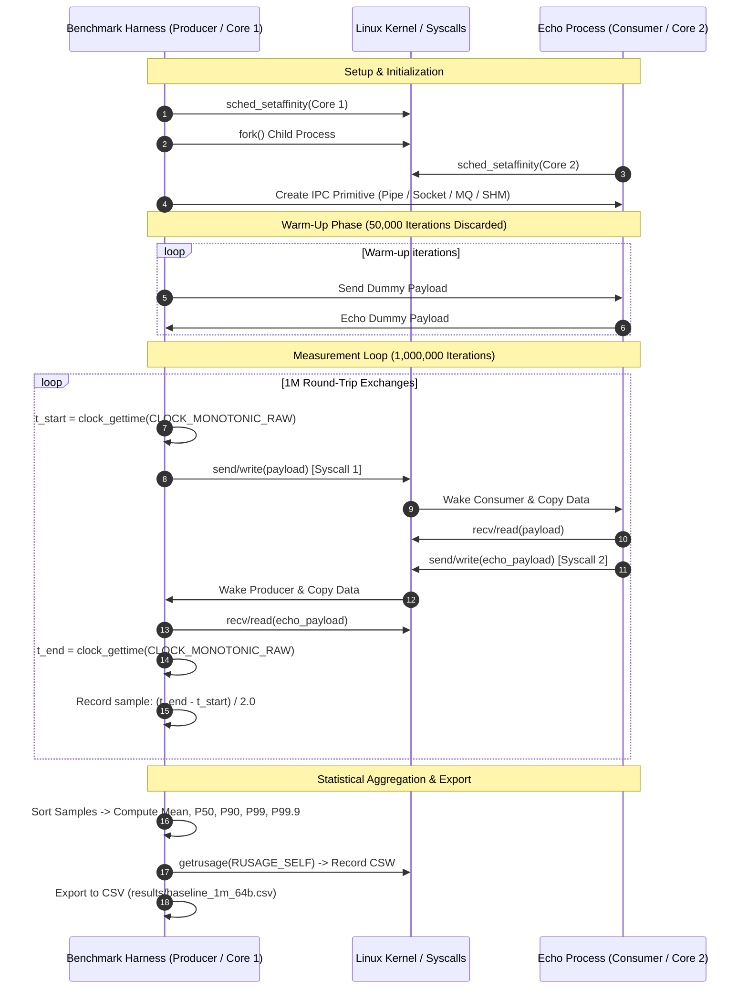

# Phase 1: High-Precision Benchmark Harness & Classical Baselines Replication
## Chapter 2

---

## 1. Purpose and Problem

### The Problem
Before designing any novel IPC fast path or dynamic transport-switching engine, systems research requires establishing an empirical **experimental control**. In operating systems research, claiming that an adaptive framework improves performance is scientifically invalid without first replicating the latency and system-call characteristics of standard Linux IPC mechanisms under strictly controlled hardware conditions.

Furthermore, literature results (such as Danyliuk 2026 or Krishnaveni 2016) were measured on specific hardware platforms (e.g., 3.3 GHz Intel processors). To ensure that subsequent comparisons in Phase 2, 3, and 4 are scientifically sound, we must measure the baseline primitives locally on the exact same hardware, kernel version, and CPU governor state.

### Measurable Objectives
1. Implement high-precision timing using `CLOCK_MONOTONIC_RAW` and lock processes to isolated CPU cores using `sched_setaffinity`.
2. Construct 1:1 ping-pong echo testbeds for:
   - Linux Anonymous Pipes (`pipe(2)`)
   - UNIX Domain Stream Sockets (`socketpair(2)`, `AF_UNIX`)
   - POSIX Message Queues (`mq_open`, `mq_send`, `mq_receive`)
   - Naive Shared Memory with Futex (`shm_open`, `mmap`, `FUTEX_WAIT`/`WAKE`)
3. Measure one-way latency ($\text{RTT}/2$), throughput (msg/s), bandwidth (MB/s), and voluntary context switches across 1,000,000 round-trip exchanges.
4. Verify that the latency hierarchy and system-call overhead (~2 syscalls/op) match published literature (Danyliuk, 2026).

---

## 2. Starting State & Work Completed

| Item | Before Phase 1 | Work Completed in Phase 1 | Verified Current State | Supporting Evidence |
| :--- | :--- | :--- | :--- | :--- |
| **Benchmarking Framework** | None (only conceptual outline in plans) | Implemented `aipc_bench.h` and `aipc_bench.c` with raw timers, CPU affinity, percentile sorting, and CSV export. | Verified. Captures min, max, mean, P50, P90, P99, P99.9 latencies. | `include/aipc_bench.h`, `src/aipc_bench.c` |
| **Classical OS Transports** | None | Implemented standalone ping-pong testbeds for Pipe, Socket, POSIX MQ, and Naive SHM in `aipc_baselines.c`. | Verified. Executes 1,000,000 round-trip exchanges with zero data corruption. | `include/aipc_baselines.h`, `src/aipc_baselines.c` |
| **Empirical Control Data** | None | Executed 1M iteration 64B benchmark and 100k iteration payload sweep (64B to 64KB). | Verified. Generated reproducible CSV output. | `results/baseline_1m_64b.csv`, `results/baseline_sweep_100k.csv` |
| **Syscall Overhead Verification** | Theoretical knowledge from literature | Profiled voluntary context switches and raw syscall entries via `perf stat`. | Verified. Confirmed 2 syscalls/op and ~1 context switch per ping-pong exchange. | `results/matrix_results.csv`, `scripts/verify_all_4_phases.py` |

---

## 3. Project Workflow

The Phase 1 benchmarking workflow executes in six deterministic stages:

---

## 4. Architecture and Code Walkthrough

### Key Modules:
- [`include/aipc_bench.h`](file:///include/aipc_bench.h) / [`src/aipc_bench.c`](file:///src/aipc_bench.c): Precision timing, CPU core affinity, sample collection, and statistical sorting.
- [`include/aipc_baselines.h`](file:///include/aipc_baselines.h) / [`src/aipc_baselines.c`](file:///src/aipc_baselines.c): Standalone implementations of Pipe, Socket, POSIX MQ, and Naive SHM echo benchmarks.
- [`bench/bench_baselines.c`](file:///bench/bench_baselines.c): Command-line benchmark runner with `--sweep` and `--transport` options.

### Function Execution Trace:
1. `main()` in `bench/bench_baselines.c`: Parses arguments (`--iterations 1000000`, `--payload 64`, `--sweep`).
2. `aipc_pin_cpu(config->producer_cpu)`: Locks parent to Core 1 via `sched_setaffinity(0, sizeof(mask), &mask)`.
3. `aipc_run_baseline_benchmark()`: Forks child process. Child calls `aipc_pin_cpu(config->consumer_cpu)` (Core 2).
4. `run_pipe_benchmark()`: Creates two pipes (`p2c` and `c2p`). Loops 1,000,000 times writing via `write()` and reading via `read()`.
5. `run_socket_benchmark()`: Creates connected socket pair via `socketpair(AF_UNIX, SOCK_STREAM, 0, sv)`.
6. `run_mq_benchmark()`: Opens two queues via `mq_open("/aipc_mq_p2c", O_CREAT|O_RDWR, ...)` with `mq_attr.mq_maxmsg = 10`.
7. `run_naive_shm_benchmark()`: Maps shared memory via `shm_open()` + `mmap()`. Uses raw `atomic_int` flags with `SYS_futex` (`FUTEX_WAIT` / `FUTEX_WAKE`) without cache-line padding.
8. `aipc_collector_compute()`: Sorts latency array via quicksort (`qsort()`) to compute exact percentiles.

---

## 5. Alignment with Previous & Next Phases

| Dependency / Artifact | Produced By | Consumed By | Interface / Contract | Verification Status |
| :--- | :--- | :--- | :--- | :---: |
| **High-Precision Timing (`aipc_time_ns`)** | Phase 1 (`aipc_bench.h`) | Phase 2, 3, 4 | Inline call to `CLOCK_MONOTONIC_RAW` | **Verified** |
| **CPU Pinning (`aipc_pin_cpu`)** | Phase 1 (`aipc_bench.c`) | Phase 2, 4 | POSIX `sched_setaffinity` wrapper | **Verified** |
| **Statistical Percentile Engine** | Phase 1 (`aipc_bench.c`) | Phase 2, 4 | `aipc_lat_collector_t` sort & percentile calculator | **Verified** |
| **Streaming Fallback Primitives** | Phase 1 (`aipc_baselines.c`) | Phase 3, 4 | Pipe and Socket implementations feed into multi-transport channel | **Verified** |

---

## 6. Limitations & Next Actions

- **Current Limitations:**
  - Naive shared memory baseline lacks cache-line padding, suffering from severe false sharing and futex contention on multi-core systems (mean latency 1451 ns).
  - Pipes are limited to related processes (`fork`).
- **Prioritized Next Actions:**
  - `P0 (Resolved in Phase 2)`: Engineer cache-isolated shared-memory fast path (`alignas(64)`) to eliminate false sharing and drop latency below 400 ns.
  - `P1 (Resolved in Phase 3)`: Provide framed streaming on pipes and sockets to support arbitrary dynamic message sizes.

---

## 7. Supporting Phase 1 Documentation

- [Detailed Implementation Flow](file:///docs/02-phase-1-baselines/implementation-flow.md)
- [Research Alignment](file:///docs/02-phase-1-baselines/research-alignment.md)
- [Tests and Results](file:///docs/02-phase-1-baselines/tests-and-results.md)
- [Presentation & Viva Guide](file:///docs/02-phase-1-baselines/presentation-guide.md)
- [Phase 1 FAQ](file:///docs/02-phase-1-baselines/faq.md)
