# Phase 2: Ultra-Low Latency Lock-Free FAS-IPC Engine
## Chapter 3

---

## 1. Purpose and Problem

### The Problem
In Phase 1, our baseline benchmarks revealed that classical Linux IPC primitives (Pipes, Sockets, and POSIX Queues) hit an impenetrable latency floor of ~1.3–1.6 μs, caused by two mandatory system calls and voluntary context switches on every message exchange. Even naive shared memory with futex synchronization yielded a disappointing 1.45 μs due to cross-core CPU cache line contention (false sharing under the MESI protocol) and immediate futex sleep penalties.

Danyliuk (2026) reported an empirical shared-memory latency baseline of ~850 ns for 64-byte messages. Our Phase 2 objective was to engineer an ultra-low latency, lock-free shared memory fast path—designated **FAS-IPC**—that eradicates false sharing, eliminates kernel transitions in steady-state streaming, and decisively outperforms Danyliuk's 850 ns baseline with a target of $< 400$ ns.

### Measurable Objectives
1. Implement a lock-free Single-Producer Single-Consumer (SPSC) circular ring buffer (`1024` slots $\times$ `1024` bytes) mapped into shared memory via `shm_open()` and `mmap()`.
2. Guarantee strict 64-byte hardware cache line isolation (`alignas(64)`) separating producer indices (`tail`), consumer indices (`head`), and synchronization coordination variables (`futex_word`).
3. Implement **Adaptive Hybrid Spin-Park (AHSP)**: execute a bounded micro-spin loop (200 iterations of `_mm_pause()`, consuming ~250–350 ns) before parking via `SYS_futex` (`FUTEX_WAIT_PRIVATE`).
4. Validate structural alignment and offset isolation via unit assertions.
5. Verify zero message loss, corruption, or reordering across 5,000,000 continuous stress transfers.
6. Achieve $< 400$ ns mean one-way latency at 64 bytes and 0 system calls per operation during steady-state streaming.

---

## 2. Starting State & Work Completed

| Item | Before Phase 2 | Work Completed in Phase 2 | Verified Current State | Supporting Evidence |
| :--- | :--- | :--- | :--- | :--- |
| **Shared Memory Architecture** | Naive unaligned SHM in `aipc_baselines.c` (1451 ns latency) | Implemented `aipc_fas_ring.h` and `aipc_fas_ring.c` with 64-byte cache isolation and duplex ring mapping. | Verified. `sizeof(fas_control_header_t)` contains exactly 3 isolated cache lines. | `include/aipc_fas_ring.h`, `src/aipc_fas_ring.c` |
| **Synchronization** | Unconditional immediate futex calls (`SYS_futex`) | Implemented AHSP (200 `_mm_pause()` spins $\to$ `FUTEX_WAIT_PRIVATE`). | Verified. Context switches dropped by 99.98% (from 1,000,000 down to 125). | `src/aipc_fas_ring.c`, `results/fas_ipc_results.csv` |
| **Small-Message Latency** | ~1451 ns (Naive SHM); 850 ns (Danyliuk literature) | Benchmarked 1M iterations of 64B messages on FAS-IPC. | Verified. Achieved **196.17 ns** mean latency (target was $< 400$ ns). | `results/fas_ipc_results.csv` |
| **System Call Overhead** | 2 syscalls/op on classical primitives | Benchmarked steady-state saturated streaming via `perf stat`. | Verified. Recorded **0.00 syscalls/op**; all transfers absorbed in userspace memory. | `results/matrix_results.csv`, `scripts/verify_all_4_phases.py` |
| **Stress Testing** | None | Executed 5,000,000 message stress test with payload hash validation. | Verified. Zero dropped, reordered, or corrupted messages. | `bench/test_fas_ring.c` |

---

## 3. Project Workflow

The following diagram illustrates the lock-free enqueue and dequeue flow of the FAS-IPC engine:

```mermaid
flowchart TD
    subgraph PRODUCER_FLOW["Producer Fast Path (Core C1)"]
        P_Start["fas_ring_send(ring, data, len)"]
        P_CheckSlot{"Slot Available?\n(tail - cached_head < 1024)"}
        P_Reload["Reload atomic head (Acquire)"]
        P_WritePayload["Copy Payload into slot[tail & 1023]"]
        P_StoreTail["atomic_store(tail, tail + 1, Release)"]
        P_CheckWaiter{"waiting_readers > 0?"}
        P_FutexWake["syscall(SYS_futex, FUTEX_WAKE_PRIVATE, 1)"]
        P_Done["Return 0 (Success)"]
    end

    subgraph CONSUMER_FLOW["Consumer AHSP Fast Path (Core C2)"]
        C_Start["fas_ring_recv(ring, buf, max_len)"]
        C_SpinLoop["AHSP Micro-Spin Loop\n(up to 200 iterations of _mm_pause)"]
        C_CheckData{"Data Available?\n(head != tail)"}
        C_ReadPayload["Copy Payload from slot[head & 1023]"]
        C_StoreHead["atomic_store(head, head + 1, Release)"]
        C_ParkFutex["Register waiting_readers\nsyscall(SYS_futex, FUTEX_WAIT_PRIVATE)"]
        C_Done["Return Payload Length"]
    end

    P_Start --> P_CheckSlot
    P_CheckSlot -- "No" --> P_Reload --> P_CheckSlot
    P_CheckSlot -- "Yes" --> P_WritePayload
    P_WritePayload --> P_StoreTail
    P_StoreTail --> P_CheckWaiter
    P_CheckWaiter -- "No (Zero Syscall Path)" --> P_Done
    P_CheckWaiter -- "Yes" --> P_FutexWake --> P_Done

    C_Start --> C_SpinLoop
    C_SpinLoop --> C_CheckData
    C_CheckData -- "Yes (Within 200 spins)" --> C_ReadPayload
    C_CheckData -- "No (Spin Expired)" --> C_ParkFutex --> C_CheckData
    C_ReadPayload --> C_StoreHead --> C_Done
```



---

## 4. Architecture and Code Walkthrough

### Key Modules:
- [`include/aipc_fas_ring.h`](file:///include/aipc_fas_ring.h): SPSC ring buffer layout, cache-line alignment (`alignas(64)`), and control structure definition.
- [`src/aipc_fas_ring.c`](file:///src/aipc_fas_ring.c): Implementation of `fas_ring_send()`, `fas_ring_recv()`, AHSP synchronization, and `fas_channel_create()`.
- [`bench/test_fas_ring.c`](file:///bench/test_fas_ring.c): Structural offset validation, latency benchmarking, and 5M message concurrency stress test.

### Structural Cache-Line Isolation Layout:
```c
// include/aipc_fas_ring.h
typedef struct {
    // Cache Line 0 (Offset 0 - 63): Written by PRODUCER ONLY
    alignas(64) atomic_uint_least32_t tail;
    uint32_t cached_head;
    uint8_t  pad0[56];

    // Cache Line 1 (Offset 64 - 127): Written by CONSUMER ONLY
    alignas(64) atomic_uint_least32_t head;
    uint32_t cached_tail;
    uint8_t  pad1[56];

    // Cache Line 2 (Offset 128 - 191): Synchronization & Futex coordination
    alignas(64) atomic_uint_least32_t futex_word;
    atomic_uint_least32_t waiting_readers;
    uint8_t  pad2[56];
} fas_control_header_t;
```

### Memory Ordering & Atomics:
- Producer stores `tail` with `memory_order_release` only after payload copy is complete.
- Consumer loads `tail` with `memory_order_acquire` before reading slot payload.
- Consumer stores `head` with `memory_order_release` after extracting payload.
- Producer loads `head` with `memory_order_acquire` when calculating ring capacity.

---

## 5. Alignment with Previous & Next Phases

| Dependency / Artifact | Produced By | Consumed By | Interface / Contract | Verification Status |
| :--- | :--- | :--- | :--- | :---: |
| **High-Precision Timing** | Phase 1 (`aipc_bench.h`) | Phase 2 (`test_fas_ring.c`) | `aipc_time_ns()` | **Verified** |
| **CPU Pinning** | Phase 1 (`aipc_bench.c`) | Phase 2 (`test_fas_ring.c`) | `aipc_pin_cpu(1)`, `aipc_pin_cpu(2)` | **Verified** |
| **FAS-IPC Fast-Path Ring** | Phase 2 (`aipc_fas_ring.c`) | Phase 3, 4 | `fas_channel_t` embedded in `ipc_channel_t` | **Verified** |
| **Sub-400 ns Engine** | Phase 2 | Phase 4 | Delivers small-payload (<1024B) performance leap | **Verified** |

---

## 6. Limitations & Next Actions

- **Current Limitations:**
  - Maximum payload per slot is bounded to `FAS_SLOT_MAX_SIZE` (1024 bytes). Attempting to send $> 1024$ B on FAS-IPC directly returns `-1` (parameter error).
  - Strictly Single-Producer Single-Consumer (SPSC). Concurrency among multiple producers requires external locking or queuing.
- **Prioritized Next Actions:**
  - `P0 (Resolved in Phase 3)`: Integrate FAS-IPC into the unified channel abstraction and implement dynamic crossover routing so that payloads $> 1024$ B are diverted to Pipes or Sockets.

---

## 7. Supporting Phase 2 Documentation

- [Detailed Implementation Flow](file:///docs/03-phase-2-shared-memory-engine/implementation-flow.md)
- [Research Alignment](file:///docs/03-phase-2-shared-memory-engine/research-alignment.md)
- [Tests and Results](file:///docs/03-phase-2-shared-memory-engine/tests-and-results.md)
- [Presentation & Viva Guide](file:///docs/03-phase-2-shared-memory-engine/presentation-guide.md)
- [Phase 2 FAQ](file:///docs/03-phase-2-shared-memory-engine/faq.md)
