# Phase 4: Full Experimental Matrix & Adaptation Gain Evaluation
## Chapter 5

---

## 1. Purpose and Problem

### The Problem
Up to Phase 3, we engineered individual transport components and unified them under an adaptive dispatching interface. However, the overarching scientific research question of this project remains:
> *Can runtime workload-aware selection of Linux IPC mechanisms reduce communication latency and CPU cost while increasing throughput compared with any statically selected IPC mechanism?*

To answer this question conclusively, we must execute an exhaustive experimental matrix comparing:
1. **Static Baseline: Always-Pipe**
2. **Static Baseline: Always-UNIX-Socket**
3. **Static Baseline: Always-POSIX-MQ**
4. **Static Baseline: Always-FAS-IPC (bounded to 1024 B)**
5. **Adaptive A-IPC Engine**

This evaluation must span two distinct benchmark dimensions:
- **Full-Spectrum Matrix:** 11 payload sizes from 64 bytes to 65,536 bytes (64 KB) across static and adaptive configurations to map exact latency, throughput, bandwidth, and system call boundaries.
- **Dynamic Mixed Workload:** A realistic heterogeneous traffic pattern (80% 64-byte signaling + 20% 16-kilobyte bulk data) to measure **Adaptation Gain ($G_{\text{adapt}}$)** and percentage latency reduction.

---

## 2. Starting State & Work Completed

| Item | Before Phase 4 | Work Completed in Phase 4 | Verified Current State | Supporting Evidence |
| :--- | :--- | :--- | :--- | :--- |
| **Matrix Benchmark Harness** | Standalone benchmark runners in Phase 1 and 2 | Implemented `bench/bench_matrix.c` and automated execution script `scripts/run_experiments.sh`. | Verified. Runs 11 payload sizes across all 5 configurations cleanly. | `bench/bench_matrix.c`, `scripts/run_experiments.sh` |
| **Comprehensive Matrix Data** | Isolated 64B files | Generated full matrix dataset with 48 distinct measurement rows. | Verified. Complete coverage from 64 B to 64 KB. | `results/matrix_results.csv` |
| **Mixed Workload Evaluation** | Theoretical projection | Implemented 80/20 mixed workload generator in `bench_matrix.c` and measured throughput and latency. | Verified. Adaptive A-IPC achieved 536,143 msg/s. | `results/mixed_workload_gain.csv` |
| **Adaptation Gain ($G_{\text{adapt}}$)** | Proposed formula in proposal | Formally computed $G_{\text{adapt}} = \frac{\text{Throughput}_{\text{Adaptive}}}{\max(\text{Throughput}_{\text{Static}})}$. | Verified. Achieved **$G_{\text{adapt}} = 1.88\times$** (Gate $\ge 1.80\times$). | `results/mixed_workload_gain.csv` |
| **Latency Reduction %** | Proposed metric | Formally computed $\frac{\text{Latency}_{\text{best-static}} - \text{Latency}_{\text{adaptive}}}{\text{Latency}_{\text{best-static}}} \times 100$. | Verified. Achieved **46.86% latency reduction**. | `results/mixed_workload_gain.csv` |

---

## 3. Project Workflow

The following flowchart illustrates the Phase 4 experimental evaluation methodology:

```mermaid
flowchart TD
    subgraph EXP_1["Experiment 1: Full-Spectrum Matrix Sweep"]
        M_Init["Iterate Payloads: 64B, 128B, 256B, 512B, 1KB, 2KB, 4KB, 8KB, 16KB, 32KB, 64KB"]
        M_Run["For each payload, evaluate:\n1. Always-Pipe\n2. Always-Socket\n3. Always-POSIX MQ\n4. Always-FAS-IPC (<=1KB)\n5. Adaptive A-IPC"]
        M_Record["Record Latency (Mean, P50, P90, P99, P99.9),\nThroughput (msg/s), Bandwidth (MB/s), Syscalls/op"]
        M_Export["Export to results/matrix_results.csv"]
    end

    subgraph EXP_2["Experiment 2: Dynamic Mixed Workload Evaluation"]
        W_Gen["Generate 80/20 Mixed Workload:\n• 80% Small Signaling (64 Bytes)\n• 20% Bulk Payload (16,384 Bytes)"]
        W_Exec["Run 500,000 Total Exchanges across:\n• Static Pipe\n• Static UNIX Socket\n• Static POSIX MQ\n• Adaptive A-IPC Engine"]
        W_Calc["Calculate Metrics:\n• G_adapt = Throughput_adaptive / max(Throughput_static)\n• Latency Reduction %"]
        W_Export["Export to results/mixed_workload_gain.csv"]
    end

    M_Init --> M_Run --> M_Record --> M_Export
    W_Gen --> W_Exec --> W_Calc --> W_Export
```

---

## 4. Architecture and Code Walkthrough

### Key Modules:
- [`bench/bench_matrix.c`](file:///bench/bench_matrix.c): Master experimental harness. Sets CPU affinity, initializes channel handles, loops across matrix dimensions, and exports standardized CSV outputs.
- [`scripts/run_experiments.sh`](file:///scripts/run_experiments.sh): Shell script executing pre-flight environment tuning, building binaries, and orchestrating matrix execution.
- [`scripts/run_matrix_evaluation.py`](file:///scripts/run_matrix_evaluation.py): Python test harness verifying dataset integrity and cross-checking acceptance gates.

### Mathematical Formulation of Evaluated Metrics:
1. **One-Way Latency ($\text{RTT}/2$):**
   $$L = \frac{t_{\text{recv}} - t_{\text{send}}}{2.0} \quad (\text{nanoseconds})$$
2. **Throughput (Messages Per Second):**
   $$\text{MPS} = \frac{N_{\text{iterations}}}{\Delta t_{\text{wall\_seconds}}}$$
3. **Bandwidth (Megabytes Per Second):**
   $$\text{MBps} = \frac{\text{MPS} \times \text{Payload Bytes}}{1024 \times 1024}$$
4. **Adaptation Gain ($G_{\text{adapt}}$):**
   $$G_{\text{adapt}} = \frac{\text{Throughput}_{\text{Adaptive}}}{\max(\text{Throughput}_{\text{Static-Pipe}}, \text{Throughput}_{\text{Static-Socket}}, \text{Throughput}_{\text{Static-MQ}})}$$
5. **Latency Reduction (%):**
   $$\text{Red}_{\%} = \frac{\text{Latency}_{\text{Static-Baseline}} - \text{Latency}_{\text{Adaptive}}}{\text{Latency}_{\text{Static-Baseline}}} \times 100$$

---

## 5. Alignment with Previous & Next Phases

| Dependency / Artifact | Produced By | Consumed By | Interface / Contract | Verification Status |
| :--- | :--- | :--- | :--- | :---: |
| **Classical Baselines** | Phase 1 (`aipc_baselines.c`) | Phase 4 (`bench_matrix.c`) | Serves as experimental control group | **Verified** |
| **FAS-IPC Fast Path** | Phase 2 (`aipc_fas_ring.c`) | Phase 4 (`bench_matrix.c`) | Powers $\le 1024$ B fast path in matrix | **Verified** |
| **Adaptive Selector** | Phase 3 (`aipc_selector.c`) | Phase 4 (`bench_matrix.c`) | Routes traffic dynamically in adaptive row | **Verified** |
| **Matrix Datasets** | Phase 4 (`results/*.csv`) | Phase 5 (`plot_results.py`) | Direct input for publication figures | **Verified** |

---

## 6. Limitations & Next Actions

- **Current Limitations:**
  - In mixed workload testing, Static FAS-IPC cannot participate without error because 20% of the messages (16 KB) exceed the 1024 B slot boundary, demonstrating the inherent failure of static shared memory.
- **Prioritized Next Actions:**
  - `P0 (Resolved in Phase 5)`: Feed `matrix_results.csv` and `mixed_workload_gain.csv` into automated Matplotlib plotting pipelines to generate Figure 1 through Figure 4.

---

## 7. Supporting Phase 4 Documentation

- [Detailed Implementation Flow](file:///docs/05-phase-4-experimental-evaluation/implementation-flow.md)
- [Research Alignment](file:///docs/05-phase-4-experimental-evaluation/research-alignment.md)
- [Tests and Results](file:///docs/05-phase-4-experimental-evaluation/tests-and-results.md)
- [Presentation & Viva Guide](file:///docs/05-phase-4-experimental-evaluation/presentation-guide.md)
- [Phase 4 FAQ](file:///docs/05-phase-4-experimental-evaluation/faq.md)
