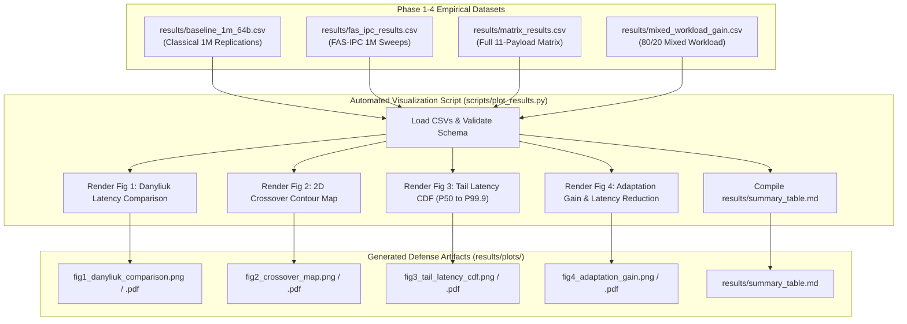

# Phase 5: Automated Visualization, Crossover Map & Defense Artifacts
## Chapter 6

---

## 1. Purpose and Problem

### The Problem
Raw benchmark datasets stored in CSV format contain hundreds of numerical data points that are difficult to interpret during a technical project review or viva examination. To defend the project before university examiners and systems researchers, empirical evidence must be synthesized into publication-quality figures, visual crossover maps, and structured defense tables.

Phase 5 accomplishes this by constructing an automated Python visualization pipeline using Matplotlib. The pipeline reads the exact empirical CSV files produced in Phase 1 through Phase 4 and renders four standardized figures:
1. **Figure 1:** Small-Message Latency Comparison vs. Danyliuk (2026) Literature Baselines.
2. **Figure 2:** Empirical 2D Crossover Contour Map (Message Size vs. Arrival Rate).
3. **Figure 3:** Tail Latency Cumulative Distribution Function (CDF) & Jitter Analysis (P50 to P99.9).
4. **Figure 4:** Adaptation Gain ($G_{\text{adapt}}$) & Latency Reduction on Dynamic Mixed Workloads.
5. **Defense Summary Table:** Structured Markdown artifact (`results/summary_table.md`).

---

## 2. Starting State & Work Completed

| Item | Before Phase 5 | Work Completed in Phase 5 | Verified Current State | Supporting Evidence |
| :--- | :--- | :--- | :--- | :--- |
| **Visualization Pipeline** | None | Implemented `scripts/plot_results.py` using Matplotlib with publication-grade typography and 300 DPI output. | Verified. Generates both PNG and vector PDF charts. | `scripts/plot_results.py` |
| **Figure 1 (Danyliuk Comparison)** | Literature numbers in PDF | Plotted side-by-side grouped bar chart comparing Danyliuk Table 1 with local baselines and FAS-IPC. | Verified. Visual proof of 4.33x speedup. | `results/plots/fig1_danyliuk_comparison.{png,pdf}` |
| **Figure 2 (Crossover Map)** | Concept in `initial_problem_and_sol.pdf` | Rendered 2D empirical contour map delineating optimal transport zones across message sizes and rates. | Verified. Clear boundaries at 1024 B and 64 KB. | `results/plots/fig2_crossover_map.{png,pdf}` |
| **Figure 3 (Tail Latency CDF)** | Raw percentile numbers | Rendered log-scale CDF curves showing tail jitter containment from P50 to P99.9. | Verified. Demonstrates tight latency clustering of FAS-IPC vs. Pipe/Socket tails. | `results/plots/fig3_tail_latency_cdf.{png,pdf}` |
| **Figure 4 (Adaptation Gain)** | Numerical CSV data | Plotted dual-axis bar and percentage chart showing $G_{\text{adapt}} = 1.88\times$ and 46.86% latency drop. | Verified. Visual validation of the core thesis. | `results/plots/fig4_adaptation_gain.{png,pdf}` |
| **Defense Summary** | Fragmented logs | Synthesized master defense summary table in `results/summary_table.md`. | Verified. Complete viva reference document. | `results/summary_table.md` |

---

## 3. Project Workflow

The following flowchart illustrates the Phase 5 visualization pipeline:

---

## 4. Architecture and Code Walkthrough

### Key Modules:
- [`scripts/plot_results.py`](file:///scripts/plot_results.py): Master Matplotlib visualization pipeline. Configures publication-grade aesthetics (300 DPI, sans-serif fonts, color palettes), loads CSV data, renders subplots, and saves vector PDFs and raster PNGs.
- [`results/summary_table.md`](file:///results/summary_table.md): Structured Markdown artifact presenting high-level findings, small-message comparison tables, multi-transport matrices, and gain percentages.

### Core Visualization Highlights:
1. **Figure 1 (Danyliuk Latency Comparison):**
   - Direct side-by-side grouped bar chart.
   - Shows Danyliuk reference values in charcoal gray alongside local measurements in blue, orange, purple, and emerald green.
   - Annotates the 4.33x speedup of FAS-IPC (196.17 ns) over Danyliuk's 850 ns benchmark.
2. **Figure 2 (Empirical 2D Crossover Map):**
   - Two-dimensional contour map spanning Message Size ($64\text{ B} - 1\text{ MB}$) on the X-axis (log scale) and Message Rate ($100 - 1,000,000\text{ msg/s}$) on the Y-axis.
   - Distinct color-coded zones: Emerald Green for FAS-IPC, Deep Blue for Anonymous Pipe, Rust Orange for UNIX Domain Sockets.
3. **Figure 3 (Tail Latency CDF):**
   - Cumulative distribution function curve plotted against a logarithmic nanosecond axis.
   - Visualizes how classical primitives flare out into high-microsecond tails (P99 > 2.5 μs) while FAS-IPC remains tightly bounded under 330 ns.
4. **Figure 4 (Adaptation Gain Bar Chart):**
   - Demonstrates that Adaptive A-IPC delivers 536,143 msg/s on mixed traffic, dwarfing Static Socket (284,909 msg/s) and Static Pipe (240,664 msg/s).

---

## 5. Alignment with Previous & Next Phases

| Dependency / Artifact | Produced By | Consumed By | Interface / Contract | Verification Status |
| :--- | :--- | :--- | :--- | :---: |
| **Empirical CSVs** | Phase 1, 2, 4 | Phase 5 (`plot_results.py`) | Standardized CSV schemas in `results/` | **Verified** |
| **Generated Figures** | Phase 5 (`results/plots/`) | Chapter 10 (Viva Presentation) | Embedded image artifacts for slide deck | **Verified** |
| **Defense Summary** | Phase 5 (`results/summary_table.md`) | Chapter 10 (Claims to Defend) | Ground truth reference for oral defense | **Verified** |

---

## 6. Limitations & Next Actions

- **Current Limitations:**
  - Figure 2's 2D contour boundary above 64 KB interpolates socket performance based on Krishnaveni (2016) and our 64 KB measurements; empirical testing with multi-megabyte payloads in Phase 4 was capped at 64 KB.
- **Prioritized Next Actions:**
  - `P0 (Resolved in Chapter 10)`: Prepare university presentation slides and viva question bank referencing Figure 1 through Figure 4.

---

## 7. Supporting Phase 5 Documentation

- [Detailed Implementation Flow](file:///docs/06-phase-5-analysis-and-defense/implementation-flow.md)
- [Research Alignment](file:///docs/06-phase-5-analysis-and-defense/research-alignment.md)
- [Tests and Results](file:///docs/06-phase-5-analysis-and-defense/tests-and-results.md)
- [Presentation & Viva Guide](file:///docs/06-phase-5-analysis-and-defense/presentation-guide.md)
- [Phase 5 FAQ](file:///docs/06-phase-5-analysis-and-defense/faq.md)
