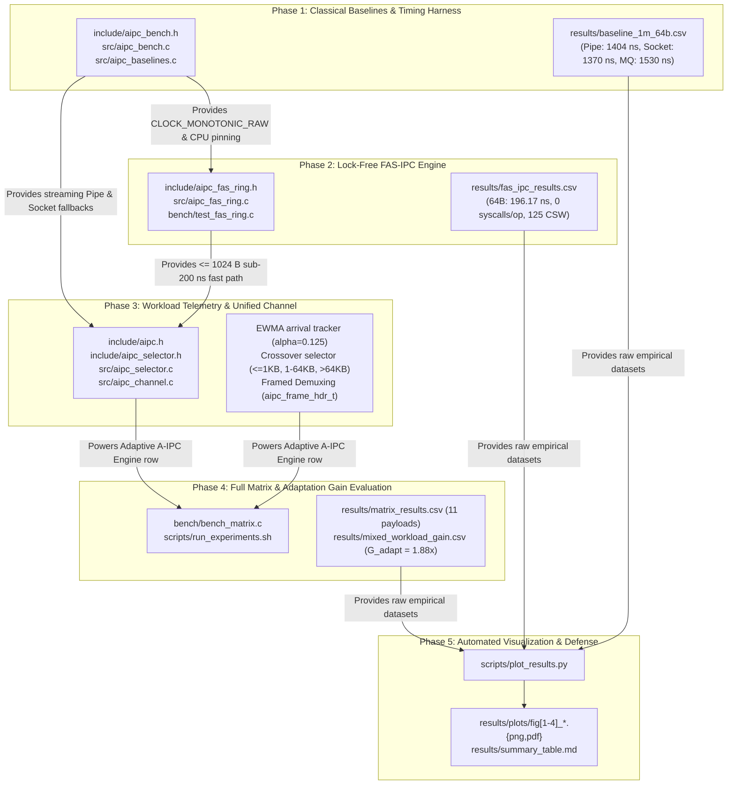

# Chapter 7: Cross-Phase Traceability
## Complete Requirements Traceability & Architectural Evolution

---

## 1. Executive Summary

A critical criterion of research integrity and high-distinction engineering is **end-to-end traceability**. Every claim made in the project proposal, presentation, or thesis must be traceable forward to concrete source code, reproducible test harnesses, empirical data files, and valid conclusions. Conversely, every piece of source code in the repository must be traceable backward to a specific research requirement or literature observation.

This chapter establishes full bidirectional traceability across the 5 project phases:
1. **Master Phase Dependencies**: How each phase consumes artifacts from preceding phases and delivers capabilities to subsequent phases.
2. **Requirements Traceability Matrix**: Mapping:
   $$\text{Research Hypothesis} \longrightarrow \text{Requirement} \longrightarrow \text{Design Decision} \longrightarrow \text{Source Code} \longrightarrow \text{Test Evidence} \longrightarrow \text{Result} \longrightarrow \text{Presentation Claim}$$
3. **Architecture Evolution**: How the codebase grew systematically from an isolated benchmark harness in Phase 1 to a unified adaptive runtime framework in Phase 5.

---

## 2. Master System Dependency Diagram

---

## 3. Chapter Structure

- [Phase Dependencies](file:///docs/07-cross-phase-traceability/phase-dependencies.md): Explicit interfaces, inputs, and outputs across all phases.
- [Requirements Traceability Matrix](file:///docs/07-cross-phase-traceability/requirements-traceability.md): The exhaustive claim-to-code traceability matrix.
- [Architecture Evolution](file:///docs/07-cross-phase-traceability/architecture-evolution.md): Historical evolution and design rationale across the project lifecycle.
