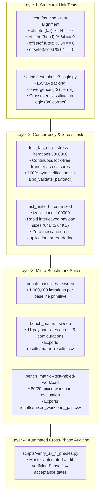

# Chapter 8: Testing & Reproducibility
## Benchmark Rigor, Stress Testing, and Independent Reproduction

---

## 1. Executive Summary

A core requirement of systems research and academic integrity is that all experimental claims must be **independently reproducible**. An external researcher with access to a Linux machine must be able to clone the repository, run automated setup and build scripts, execute the test suite, and obtain benchmark results matching our reported findings within normal statistical variance.

This chapter details our experimental methodology, testing rigor, and reproducibility instructions:
1. **Benchmark Methodology:** Precision timing using `CLOCK_MONOTONIC_RAW`, CPU core pinning, cache warm-up policies, and statistical percentile sorting.
2. **Correctness & Stress Testing:** Data integrity payload generation, hash verification, structural alignment unit assertions, and 5,000,000-message concurrency stress tests.
3. **Reproduction Guide:** Complete, step-by-step terminal instructions to build, configure, benchmark, and visualize the entire project.
4. **Threats to Validity:** Detailed analysis of construct, internal, external, and statistical conclusion validity.

---

## 2. Testing Framework Architecture

The testing architecture encompasses four complementary testing layers:

---

## 3. Chapter Structure

- [Benchmark Methodology](file:///docs/08-testing-and-reproducibility/benchmark-methodology.md): Hardware isolation, timer characteristics, and statistical treatment.
- [Correctness and Stress Testing](file:///docs/08-testing-and-reproducibility/correctness-and-stress-testing.md): Data integrity verification and memory sanitization.
- [Reproduction Guide](file:///docs/08-testing-and-reproducibility/reproduction-guide.md): Step-by-step commands to replicate all results from scratch.
- [Threats to Validity](file:///docs/08-testing-and-reproducibility/threats-to-validity.md): Detailed disclosure of experimental biases and assumptions.
