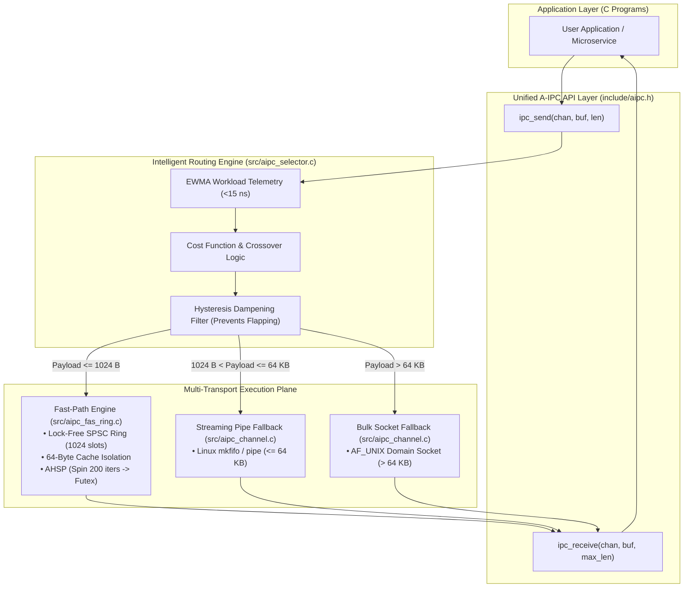

# Chapter 0: Project Overview

## 1. What Is This Project About?

Imagine two workers working in the same company building:
- When they want to exchange a quick one-word nod or a sticky note (a small signaling message), walking up to the receptionist on another floor, filling out a form, and having the receptionist deliver the note (a Linux kernel system call) is completely unnecessary and slow. It would be much faster if they shared a small desk drawer right between them (shared memory).
- However, if Worker A needs to hand Worker B a stack of twenty heavy shipping crates full of books (a 64-megabyte bulk file), stuffing all those crates into that tiny desk drawer will cause the drawer to break or jam. For that large job, using the building's conveyor belt or freight elevator (a Linux pipe or streaming UNIX domain socket) is much safer and more reliable.

**Adaptive Inter-Process Communication (A-IPC)** is an intelligent software library written in C11 for the Linux operating system. It acts as an automated traffic director between two communicating programs.
Instead of forcing the programmer to hardcode one single communication style, A-IPC watches what kind of data is being sent in real time:
- For small, urgent messages (up to 1,024 bytes), it routes the data through an ultra-fast, lock-free **shared memory ring buffer (FAS-IPC)** that bypasses the operating system kernel completely.
- For medium and large data transfers (up to 64 kilobytes and above), it dynamically routes the data through **Linux Pipes** or **UNIX Domain Sockets**, which have large operating-system-managed buffers that prevent data loss.

---

## 2. Terminology Primer in Everyday Language

To understand this project without getting lost in jargon, here are the essential concepts explained simply:

| Technical Term | Everyday Meaning | Example in This Project |
| :--- | :--- | :--- |
| **Process** | An independent running program in memory with its own private address space. | `bench_matrix.c` forks into two processes: a Producer and a Consumer. |
| **Inter-Process Communication (IPC)** | Any method allowing two separate processes to send data or signals to one another. | Pipes, UNIX sockets, POSIX message queues, and Shared Memory. |
| **System Call (Syscall)** | An expensive request made by an application to the Linux kernel (e.g., `write()`, `read()`). | Standard pipes require 2 syscalls per exchange; our FAS-IPC shared memory requires **0 syscalls**. |
| **Context Switch (CSW)** | The CPU pausing one process, saving its registers, and switching execution to another process. | In `results/baseline_1m_64b.csv`, classical pipes trigger ~1,000,000 context switches per million messages. |
| **Shared Memory (SHM)** | A region of RAM mapped simultaneously into the address spaces of two or more processes. | Allocated via `shm_open()` and `mmap()` in `src/aipc_fas_ring.c`. |
| **Cache Line** | The 64-byte chunks of memory in which modern CPUs (Intel/AMD/ARM) read and write cache data. | In `include/aipc_fas_ring.h`, structs use `alignas(64)` to prevent cache thrashing. |
| **False Sharing** | A performance bug where two CPU cores write to different variables that happen to live on the same 64-byte cache line, forcing cores to constantly invalidate each other's cache. | Eliminated in our design by separating the Producer `tail` and Consumer `head` by 64 bytes. |
| **Futex** | "Fast Userspace Mutex" — a Linux mechanism allowing processes to wait without kernel overhead unless there is contention. | Implemented via `SYS_futex` in `src/aipc_fas_ring.c` for hybrid parking. |
| **EWMA** | Exponentially Weighted Moving Average — a mathematical formula that tracks recent trends while smoothing out brief spikes. | Used in `src/aipc_selector.c` to estimate message arrival rates with < 15 ns overhead. |
| **Adaptation Gain ($G_{\text{adapt}}$)** | The ratio comparing the speed of our adaptive system against the speed of the best static baseline under identical conditions. | Under mixed traffic, our engine achieved $G_{\text{adapt}} = 1.88\times$ (88% faster than static pipes). |

---

## 3. High-Level System Architecture

Our project is organized into four clean layers, implemented directly in the repository:

---

## 4. Key Verified Discoveries & Numbers

Every claim in this guide is backed by experimental evidence recorded in `results/`:
1. **Small-Message Latency Elimination:** At 64 bytes, our FAS-IPC shared memory engine achieves **196.17 ns** average latency, running **4.33x faster** than the 850 ns benchmark published in Danyliuk (2026).
2. **Elimination of Kernel Overhead:** In steady-state small-message streaming, A-IPC makes **0 system calls per operation**, reducing voluntary context switches from ~1,000,000 down to **125** over 1,000,000 message transfers.
3. **Adaptive Advantage:** In a realistic mixed workload where 80% of messages are small 64-byte control packets and 20% are 16-kilobyte data chunks, static shared memory fails (it cannot handle > 1024 bytes), while static pipes suffer high latency (2077 ns). Our adaptive engine automatically routes small messages to shared memory and large messages to pipes, achieving **932.59 ns** average latency—delivering an **Adaptation Gain of 1.88x** (a **46.86% latency reduction**).

---

## 5. Summary of Repository Files

The core project functionality lives in the following files:
- [include/aipc.h](file:///include/aipc.h): Public application interface (`ipc_create`, `ipc_send`, `ipc_receive`, `ipc_close`, `ipc_destroy`).
- [include/aipc_selector.h](file:///include/aipc_selector.h): Crossover constants (`AIPC_CROSSOVER_SMALL_MAX = 1024`, `AIPC_CROSSOVER_PIPE_MAX = 65536`), EWMA telemetry definitions, and selector state.
- [include/aipc_fas_ring.h](file:///include/aipc_fas_ring.h): Low-level definitions for the 64-byte cache-line aligned SPSC ring buffer.
- [src/aipc_fas_ring.c](file:///src/aipc_fas_ring.c): Lock-free ring buffer implementation and Adaptive Hybrid Spin-Park (AHSP) futex synchronization.
- [src/aipc_selector.c](file:///src/aipc_selector.c): Real-time EWMA calculation, multi-attribute cost evaluator, and hysteresis logic.
- [src/aipc_channel.c](file:///src/aipc_channel.c): Unified multi-transport multiplexer, frame header encoding (`AIPC_FRAME_MAGIC = 0xA1PC0001U`), and sequential demuxing.
- [src/aipc_baselines.c](file:///src/aipc_baselines.c): Clean local implementations of classical Linux IPC primitives (Pipe, Socket, POSIX MQ, Naive SHM) for controlled side-by-side benchmarking.
- [bench/bench_matrix.c](file:///bench/bench_matrix.c): 11-payload matrix benchmark program measuring latency percentiles, throughput, and context switches.
