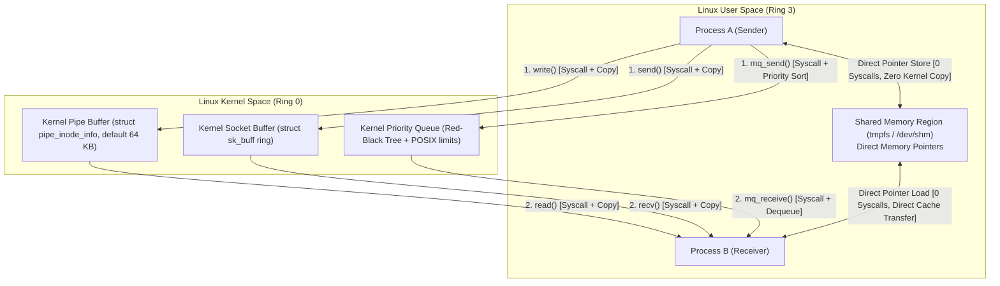

# Chapter 2: Linux IPC Fundamentals

## 1. Introduction to Linux Inter-Process Communication

In the Linux operating system, processes are isolated from each other by default. To collaborate, they rely on built-in operating system mechanisms known as **Inter-Process Communication (IPC)** primitives.

This chapter breaks down the five primary IPC mechanisms available in Linux, explains how each one operates under the hood, details their micro-architectural costs (system calls, memory copies, and CPU cache behavior), and explains why their performance changes dramatically depending on message size.

---

## 2. Detailed Breakdown of Linux IPC Primitives

---

### A. Anonymous Pipes & Named FIFOs
- **How It Works:** A pipe is a unidirectional FIFO (First-In, First-Out) byte stream managed inside the Linux kernel via a circular array of memory pages (`struct pipe_inode_info`).
  - *Anonymous Pipes* (`pipe(fd)`) are anonymous in the filesystem and can only be shared between related parent/child processes created via `fork()`.
  - *Named Pipes / FIFOs* (`mkfifo(path)`) appear as a special FIFO file node on the filesystem, allowing unrelated processes to open them by filename.
- **Data Flow & Copies:** 
  1. Process A calls `write(fd, buf, len)` (System Call 1: user space to kernel buffer copy).
  2. The Linux kernel buffers the data in page-sized blocks (default buffer capacity is 64 KB, configurable via `fcntl(F_SETPIPE_SZ)`).
  3. Process B calls `read(fd, buf, len)` (System Call 2: kernel buffer to user space copy).
- **Strengths:** 
  - Extremely simple streaming semantics.
  - Automatic kernel backpressure: if the 64 KB pipe buffer becomes full, `write()` blocks until the reader drains data.
  - Highly optimized in modern Linux kernels for medium-sized streaming data.
- **Weaknesses:**
  - Unidirectional: requires two separate pipes for bi-directional communication.
  - No message framing: pipes are raw byte streams. If you write 10 bytes and then 20 bytes, the reader might read all 30 bytes in a single `read()`, requiring user-space framing headers.
  - Minimum of 2 system calls and 2 memory copies per message exchange.

---

### B. UNIX Domain Sockets (`AF_UNIX`)
- **How It Works:** Part of the Berkeley Sockets API, UNIX domain sockets provide full-duplex (two-way) communication between processes on the same host using standard socket file descriptors.
  - Stream sockets (`SOCK_STREAM`): reliable, sequenced, bi-directional byte stream (similar to local TCP).
  - Datagram sockets (`SOCK_DGRAM`): discrete message packets (similar to local UDP).
- **Data Flow & Copies:**
  1. Producer calls `send()` or `write()`.
  2. The kernel allocates a socket buffer structure (`struct sk_buff`) and copies the payload into kernel memory.
  3. The consumer calls `recv()` or `read()`, copying data from `sk_buff` into the consumer's memory buffer.
- **Strengths:**
  - Robust connection lifecycle management (`listen()`, `accept()`, `connect()`).
  - Native bi-directionality over a single pair of file descriptors.
  - Ability to pass open file descriptors across processes using ancillary control data (`SCM_RIGHTS`).
  - Superior scalability when transferring large, multi-megabyte payloads because the kernel dynamically sizes socket buffers.
- **Weaknesses:**
  - High system call overhead for small payloads.
  - Heavy socket buffer allocation and protocol stack state machine processing compared to lightweight pipes.

---

### C. POSIX Message Queues (`mq_open`, `mq_send`, `mq_receive`)
- **How It Works:** POSIX message queues provide discrete, prioritized message transmission managed by the kernel's virtual filesystem (`mqueue`).
- **Data Flow & Copies:**
  1. Producer calls `mq_send()`, passing a message payload and an integer priority level.
  2. The kernel locks the queue and inserts the message into a priority-ordered red-black tree or sorted linked list.
  3. Consumer calls `mq_receive()`, retrieving the highest-priority oldest message.
- **Strengths:**
  - Preserves discrete message boundaries (no custom framing required).
  - Native message prioritization: high-priority emergency packets jump ahead of routine messages.
  - Asynchronous notification capability via signals (`mq_notify`).
- **Weaknesses:**
  - **Severe latency overhead:** In our Phase 1 benchmarks (`baseline_1m_64b.csv`), POSIX MQ recorded the highest mean latency (~1,530 ns) and, in literature (Danyliuk 2026), reached ~14.5 μs on older kernels.
  - Restrictive system limits: by default, Linux caps queue capacity to 10 messages of 8,192 bytes each (`/proc/sys/fs/mqueue/msg_max`), causing queue saturation under heavy traffic.

---

### D. Shared Memory (`shm_open`, `mmap`)
- **How It Works:** Shared memory completely bypasses kernel mediation during data exchange.
  1. Process A creates a POSIX shared memory object using `shm_open("/name", O_CREAT | O_RDWR, 0666)`.
  2. It sizes the segment using `ftruncate(fd, size)`.
  3. Both Process A and Process B map the physical RAM pages into their private virtual address spaces using `mmap()`.
- **Data Flow & Copies:**
  - When Process A writes to the shared memory pointer, the CPU writes directly to the physical RAM page (or CPU L1/L2 cache).
  - When Process B reads from the pointer, it reads directly from the same physical RAM page.
  - **Result: Zero system calls during data transfer, zero copies into kernel space.**
- **Strengths:**
  - Absolute fastest theoretical and practical throughput for local data exchange.
  - Sub-microsecond latency (in our FAS-IPC implementation, as low as **196.17 nanoseconds**).
- **Weaknesses:**
  - **No built-in synchronization:** Unlike pipes or sockets, shared memory does not alert the receiver when data arrives. The programmer must implement synchronization (semaphores, mutexes, futexes, or atomic variables).
  - **Fixed memory sizing:** Once mapped, expanding a shared memory ring buffer dynamically requires expensive unmapping, truncating, and re-mapping across multiple processes.
  - **Cache coherency and false sharing pitfalls:** If multiple CPU cores write to adjacent variables, CPU cache coherence protocols can devastate performance.

---

## 3. Micro-Architectural Costs: Why IPC Is Not Free

When comparing IPC performance, three hidden hardware factors dictate the measured latency:

### 1. The Cost of a System Call (Ring 3 $\leftrightarrow$ Ring 0)
When a program calls `read()` or `write()`, the CPU executes a special machine instruction (`syscall`).
- The CPU switches privilege levels from user mode (Ring 3) to kernel mode (Ring 0).
- The CPU hardware saves user-space registers to the kernel stack.
- Kernel security mitigations (such as KPTI — Kernel Page Table Isolation, Meltdown/Spectre mitigations) force address space transitions.
- A single system call incurs a baseline cost of ~200 to 500 nanoseconds on modern x86_64 processors. A two-way ping-pong exchange requiring 4 syscalls wastes over 1,000 nanoseconds before a single byte of user logic executes!

### 2. Context Switches (Voluntary vs. Involuntary)
- A **voluntary context switch** occurs when a process yields the CPU because it has to wait for data (e.g., blocking on an empty pipe or socket).
- When Process A sleeps, the Linux scheduler picks Process B, swaps the memory management page tables (CR3 register), and restores Process B's execution state.
- Switching contexts flushes the CPU's Translation Lookaside Buffer (TLB) and evicts hot data from L1/L2 caches, resulting in thousands of clock cycles of latency.

### 3. CPU Cache Hierarchy & The MESI Protocol
Modern multi-core processors use a cache coherency protocol called **MESI** (Modified, Exclusive, Shared, Invalid) to ensure all cores see consistent memory:
- **False Sharing:** If the Producer core writes to variable `tail` and the Consumer core writes to variable `head`, and both variables sit on the same 64-byte chunk of memory (cache line), the CPU cores will continuously bounce the cache line between each other across the inter-core interconnect.
- Every write by Core 1 invalidates Core 2's L1 cache, adding 40–100 ns of delay per access.
- In our project, we solve this by isolating control variables onto separate 64-byte cache lines using `alignas(64)`.

---

## 4. Comprehensive Comparison Matrix of Linux IPC Primitives

| IPC Primitive | Kernel Mediated? | System Calls per Transfer | Max Practical Payload | Message Boundaries? | Native Bi-directional? | Primary Use Case in Industry |
| :--- | :---: | :---: | :---: | :---: | :---: | :--- |
| **Anonymous Pipe** | Yes | 2 (`write`/`read`) | ~64 KB per batch | No (Raw Stream) | No (Unidirectional) | Shell command pipelines (`ls \| grep`) |
| **Named FIFO** | Yes | 2 (`write`/`read`) | ~64 KB per batch | No (Raw Stream) | No (Unidirectional) | Simple daemon logging, systemd service pipes |
| **UNIX Domain Socket** | Yes | 2 (`send`/`recv`) | Multi-MB | Configurable (Stream/Dgram) | Yes (Full Duplex) | Docker daemon, MySQL local client, Redis |
| **POSIX Message Queue** | Yes | 2 (`mq_send`/`mq_receive`)| Restricted (Default 8 KB) | Yes (Discrete Messages) | No (Queue-based) | Real-time industrial control, prioritized tasks |
| **Naive SHM + Mutex** | Partial | 2–4 (`futex`/`sem_wait`) | Unlimited by RAM | Depends on design | Yes (Shared buffer) | Legacy database page sharing (PostgreSQL) |
| **Our FAS-IPC (Lock-Free SHM)** | **No** | **0 (Zero in steady state)** | Up to 1,024 B | Yes (Framed slots) | Yes (Duplex twin-ring) | Ultra-low latency signaling, HFT, A-IPC fast path |

---

## 5. Summary: Why We Need Workload-Aware Adaptation

As demonstrated above:
- **Shared memory** dominates small payloads (sub-200 ns latency), but is constrained by slot sizes and fixed allocations.
- **Pipes and UNIX sockets** dominate large, streaming payloads (handling tens of megabytes effortlessly), but suffer severe syscall and context-switching penalties on small messages.

An adaptive framework that automatically selects the right transport based on payload size and arrival rate provides the best of both worlds without forcing developers to make a painful compile-time compromise.
