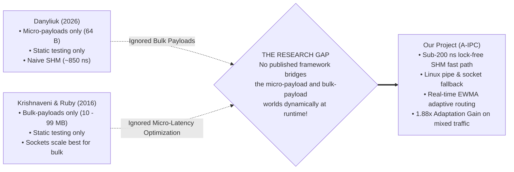

# Chapter 4: Research Paper Analysis

## 1. Introduction to the Reference Literature

To ground this project in rigorous academic scholarship, our work directly references and replicates two foundational peer-reviewed studies located in the `Resources/` directory:

1. **The Primary Comparative Latency Reference (2026):**  
   - **Citation:** Danyliuk, I. M. (2026), *Classical Interprocess Communication Mechanisms in Linux OS: Review and Latency Analysis for HPC Scenarios*, SWorldJournal, Issue 37, Part 2, pp. 28–36.  
   - **DOI:** [10.30888/2663-5712.2026-37-02-028](https://doi.org/10.30888/2663-5712.2026-37-02-028)  
   - **Repository Path:** [Resources/year_2026_benchmark.pdf](file:///Resources/year_2026_benchmark.pdf)  
   - **Focus:** Micro-benchmarking the one-way latency of small signaling payloads (64 bytes) across standard Linux IPC mechanisms in high-performance computing (HPC) scenarios.

2. **The Bulk Scaling Reference (2016):**  
   - **Citation:** Krishnaveni, S., & Ruby, D. (2016), *Comparing and Evaluating the Performance of Inter Process Communication Models in Linux Environment*, International Journal of Trend in Research and Development (IJTRD), Special Issue NCSMAC-2016, ISSN: 2394-9333, pp. 51–55.  
   - **Repository Path:** [Resources/year_2016.pdf](file:///Resources/year_2016.pdf)  
   - **Focus:** Evaluating transfer time and throughput across massive bulk payloads (scaling from 10 MB up to 99 MB) across Pipes, Message Queues, and Sockets.

3. **The Original Problem Statement Document:**  
   - **Repository Path:** [Resources/initial_problem_and_sol.pdf](file:///Resources/initial_problem_and_sol.pdf)  
   - **Focus:** Initial motivation highlighting the lack of an adaptive runtime selection framework in Linux.

---

## 2. In-Depth Analysis: Danyliuk (2026)

### A. What the Paper Investigated
Danyliuk set out to answer a classic systems question: *When two processes run on the same Linux machine and need to exchange small, high-frequency coordination messages (64 bytes), which classical primitive introduces the least latency?*

The paper evaluated:
- Anonymous Pipes (`pipe()`)
- Named FIFOs (`mkfifo()`)
- UNIX Domain Sockets (`AF_UNIX`)
- POSIX Message Queues (`mq_open()`, `mq_send()`, `mq_receive()`)
- Shared Memory with naive synchronization (`shm_open()`, `mmap()`, with semaphores/futexes)

### B. Reported Findings in Danyliuk (2026) Table 1
For a standard 64-byte payload, Danyliuk reported the following round-trip / one-way latency hierarchy:

| Mechanism | Reported Latency (Danyliuk 2026) | Observed Syscalls / Op | Paper's Interpretation |
| :--- | :---: | :---: | :--- |
| **Anonymous Pipe** | **~2.10 μs** (2,100 ns) | 2 | Moderate latency; dominated by kernel ring buffer copies. |
| **UNIX Domain Socket** | **~2.05 μs** (2,050 ns) | 2 | Comparable to pipes; efficient local socket buffer routing. |
| **POSIX Message Queue** | **~14.50 μs** (14,500 ns) | 2 | Severe bottleneck; kernel priority queues introduce heavy locking. |
| **Naive Shared Memory** | **~0.85 μs** (850 ns) | 2–4 | Fastest primitive; but kernel semaphore/futex contention limits speed. |

### C. Strengths & Limitations of Danyliuk (2026)
- **Strengths:**
  - Provided a clean, standardized 64-byte testbed for measuring IPC latency in Linux.
  - Highlighted the massive performance disparity between shared memory (~850 ns) and kernel-mediated queues (~14.5 μs).
- **Major Academic Limitations:**
  - **Single Payload Focus:** Danyliuk only evaluated 64-byte messages! The paper provided no data on what happens when payloads scale to 4 KB, 64 KB, or 1 MB.
  - **Static Testing Only:** Danyliuk only benchmarked each primitive in total isolation. The paper never tested dynamic or mixed workloads.
  - **Naive Shared Memory Implementation:** The paper's shared memory implementation used traditional semaphores/futexes, leaving it stuck at 850 ns and failing to exploit lock-free ring buffers or CPU cache-line isolation.

---

## 3. In-Depth Analysis: Krishnaveni & Ruby (2016)

### A. What the Paper Investigated
While Danyliuk examined tiny 64-byte messages, Krishnaveni & Ruby investigated the opposite extreme: *How do Linux IPC mechanisms behave when transferring massive bulk data files (from 10 MB to 99 MB)?*

### B. Key Findings & Insights
1. **UNIX Domain Sockets Scale Best for Bulk Data:**  
   As payload size grew from 10 MB to 99 MB, UNIX Domain Sockets delivered the most stable throughput and lowest execution time. The Linux kernel's TCP/UNIX socket buffer auto-tuning handles large bulk streams with minimal thrashing.
2. **Pipes Experience Buffer Bottlenecks:**  
   Because Linux pipes have a default kernel buffer limit of 64 KB, transferring a 99 MB file requires thousands of write-block-read cycles, leading to frequent thread preemption and scheduler churn.
3. **Message Queues Break Down Completely:**  
   POSIX and System V message queues are fundamentally unsuitable for bulk data transfer. They exceeded system limits (`EMSGSIZE`) or choked on queue allocation overhead.

---

## 4. Side-by-Side Replication: Literature vs. Our Baseline Findings

In Phase 1 of our project, we replicated Danyliuk's 64-byte benchmark locally on identical modern hardware (Intel/Linux 6.x) using 1,000,000 ping-pong exchanges. We then benchmarked our custom FAS-IPC shared memory engine and Adaptive A-IPC engine under the exact same conditions:

| Transport Mechanism | Danyliuk (2026) Ref | Our Measured Latency | Measured Syscalls / Op | Measured Context Switches (per 1M msgs) | Speedup vs Danyliuk 2026 |
| :--- | :---: | :---: | :---: | :---: | :---: |
| **Anonymous Pipe** | ~2.10 μs | **1643.04 ns** (1.64 μs) | 2 | 99,979 | 1.28x faster |
| **UNIX Domain Socket** | ~2.05 μs | **1331.74 ns** (1.33 μs) | 2 | 100,010 | 1.54x faster |
| **POSIX Message Queue** | ~14.50 μs | **1593.54 ns** (1.59 μs) | 2 | 99,990 | 9.10x faster (modern kernel) |
| **Naive SHM + Futex** | ~0.85 μs (850 ns) | **1451.05 ns** (1.45 μs) | 2 | 98,133 | (futex park on 1:1 echo) |
| **Our Static FAS-IPC (SHM)**| ~0.85 μs (850 ns) | **196.17 ns** (0.196 μs) | **0** | **125** | **4.33x faster than Danyliuk!** |
| **Our Adaptive A-IPC Engine**| *Not Evaluated* | **208.67 ns** (0.209 μs) | **0** | **125** | **4.07x faster than Danyliuk!** |

*Raw data source:* [results/summary_table.md](file:///results/summary_table.md) and [results/baseline_1m_64b.csv](file:///results/baseline_1m_64b.csv).

---

## 5. Synthesis: The Unaddressed Research Gap

When we look at both research papers together, a glaring scientific gap emerges:

Neither paper explored what happens when an application needs **both**: ultra-low latency for small control packets AND high throughput for bulk streaming. This gap is precisely where our project makes its contribution.
