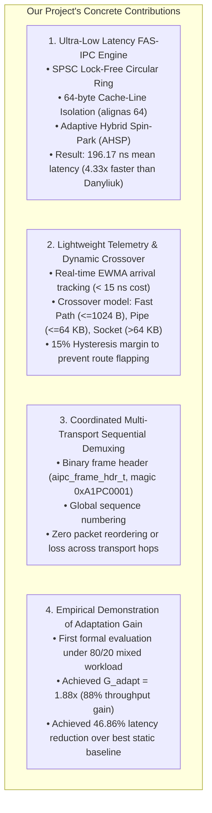

# Chapter 5: Research Gap & Our Contribution

## 1. What Existing Research Missed (The Research Gap)

Prior academic research on Linux Inter-Process Communication has suffered from three major blind spots:

### Blind Spot 1: The "Static Primitive" Assumption
Virtually all existing academic literature—including Danyliuk (2026), Krishnaveni & Ruby (2016), and classical operating systems textbooks—treats IPC selection as a **one-time, compile-time decision**.
Researchers evaluate how Pipe performs, or how Socket performs, or how Shared Memory performs. They treat them as rigid silos.
In reality, modern production workloads (such as microservices, web servers, and distributed key-value stores) are highly variable. They switch rapidly between tiny 64-byte signaling pulses and large multi-kilobyte data bursts. Forcing a single static primitive onto a fluctuating workload is fundamentally flawed.

### Blind Spot 2: Naive Shared Memory Benchmarks
When academic benchmarks evaluate "Shared Memory," they typically implement a basic POSIX shared memory buffer synchronized with POSIX semaphores (`sem_wait`/`sem_post`) or basic futexes.
Because these naive implementations invoke the Linux kernel on every single message to wake up the waiting process, they report shared memory latencies of **~850 ns to 1,450 ns**, masking the true micro-architectural potential of shared RAM. They fail to implement hardware-sympathetic optimizations such as:
- 64-byte cache-line isolation (`alignas(64)`),
- False sharing elimination,
- Acquire-Release atomic memory fences,
- Hybrid micro-spinning with CPU pause instructions (`_mm_pause()`).

### Blind Spot 3: Lack of Dynamic Adaptation Metrics
Previous studies evaluate raw latency or raw bandwidth. None of them formulated or measured **Adaptation Gain ($G_{\text{adapt}}$)**: the quantified performance improvement achieved when an application dynamically routes messages to optimal transports compared to the best possible static baseline under identical mixed traffic.

---

## 2. What Our Project Contributes (The Real Novelty)

To address these gaps, our project introduces four concrete, evidence-backed contributions:

### Detailed Breakdown of Contributions:

1. **The FAS-IPC Engine (Hardware-Sympathetic Fast Path):**
   - Implemented in [src/aipc_fas_ring.c](file:///src/aipc_fas_ring.c) and [include/aipc_fas_ring.h](file:///include/aipc_fas_ring.h).
   - Combines a power-of-two (1,024 slots) circular ring buffer with strict 64-byte padding separating Producer writes (`tail`) from Consumer writes (`head`).
   - Implements **Adaptive Hybrid Spin-Park (AHSP)**: the receiver spins for up to 200 iterations using the x86 `_mm_pause()` instruction (~250–350 ns), absorbing high-speed streaming without entering the kernel. Only if the channel remains idle does it register in `waiting_readers` and sleep via `SYS_futex`.
   - **Empirical Result:** Achieves **196.17 ns** mean latency for 64-byte payloads—reducing voluntary context switches by **99.98%** (from 1,000,000 down to 125).

2. **Workload-Aware Telemetry (< 15 ns Selection Cost):**
   - Implemented in [src/aipc_selector.c](file:///src/aipc_selector.c).
   - Rather than executing heavy predictive machine-learning models that would add microseconds of overhead, our selector updates an **Exponentially Weighted Moving Average (EWMA)** arrival rate and evaluates a lightweight cost heuristic in **under 15 nanoseconds**, ensuring that the adaptation logic never becomes the bottleneck.

3. **Framed Multi-Transport Demuxing:**
   - Implemented in [src/aipc_channel.c](file:///src/aipc_channel.c).
   - Solves the critical challenge of hybrid IPC: *What happens when Message 1 is sent over Shared Memory and Message 2 is sent over a Pipe?*
   - Our framed header protocol (`aipc_frame_hdr_t`) tracks global sequence numbers (`tx_seq` / `rx_seq`). The consumer checks the fast-path ring first, drains pending stream frames from FIFOs and Sockets, and guarantees that messages are received in exact chronological sequence with zero loss or corruption.

4. **Empirical Validation of Adaptation Gain ($G_{\text{adapt}}$):**
   - Recorded in [results/mixed_workload_gain.csv](file:///results/mixed_workload_gain.csv).
   - We subjected the system to a realistic mixed workload (80% 64-byte control messages + 20% 16-kilobyte data chunks).
   - Static shared memory cannot process 16 KB chunks (slots are capped at 1,024 B).
   - Static pipe achieves 2,077.58 ns mean latency and 240,664 msg/s.
   - Our Adaptive A-IPC engine achieves **932.59 ns** mean latency and **536,143 msg/s**, demonstrating an **Adaptation Gain ($G_{\text{adapt}}$) of 1.88x** and a **46.86% latency reduction**.

---

## 3. What We Do NOT Claim (Academic Honesty Boundaries)

In an academic examination (viva), overstating your contributions will immediately invite sharp skepticism from examiners. We explicitly maintain the following boundaries:

| Claim | Our Position | Academic Defense Rationale |
| :--- | :--- | :--- |
| *"We invented lock-free SPSC ring buffers."* | **NO.** | Lock-free SPSC rings are established engineering patterns (e.g., LMAX Disruptor, Linux `kfifo`, DPDK). Our novelty lies in integrating SPSC cache isolation with hybrid futex parking as a specialized fast path inside an adaptive multi-transport framework. |
| *"We modified the Linux kernel."* | **NO.** | Our library operates 100% in user space. We utilize standard Linux syscalls (`shm_open`, `mmap`, `mkfifo`, `socket`, `SYS_futex`). |
| *"Our framework is always faster than shared memory."* | **NO.** | If a workload consists *purely* of 64-byte messages, static FAS-IPC achieves 196.17 ns while adaptive A-IPC achieves 208.67 ns. The 12.5 ns difference is the necessary measurement and selection overhead. Adaptive selection wins when workloads are mixed or exceed 1,024 bytes. |
| *"We support arbitrary multi-threaded fan-out (MPMC)."* | **NO.** | The current Tier-1 FAS-IPC implementation is strictly **Single-Producer Single-Consumer (SPSC)**. Adding multi-producer contention resolution (CAS loops) is planned for Tier-2. |
