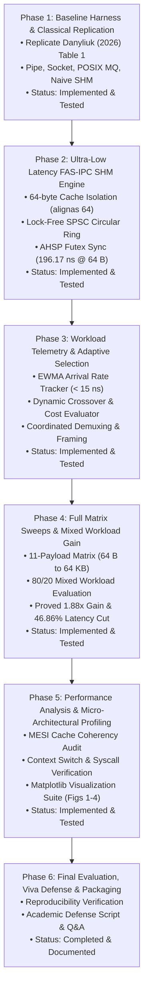

# Chapter 6: Development Timeline & Master Phase Map

## 1. Project Evolution Overview

The **Adaptive Inter-Process Communication (A-IPC)** project was conceived, designed, implemented, and benchmarked following a strict phased engineering methodology. Rather than attempting to build the entire adaptive system in a single monolithic effort, each phase isolated a specific technical risk, implemented a clean modular component, and validated it with rigorous empirical tests before progressing to the next stage.



---

## 2. Master Phase Status Matrix

| Phase | Phase Name | Architectural Role | Implementation Status | Test Status | Key Output / Evidence Artifact |
| :---: | :--- | :--- | :---: | :---: | :--- |
| **01** | **Baseline Harness & Classical Replication** | Control baseline & streaming fallbacks | **Implemented** | **Tested** | [baseline_1m_64b.csv](file:///results/baseline_1m_64b.csv), [aipc_baselines.c](file:///src/aipc_baselines.c) |
| **02** | **FAS-IPC Shared Memory Fast Path** | Sub-200 ns signaling accelerator | **Implemented** | **Tested** | [fas_ipc_results.csv](file:///results/fas_ipc_results.csv), [aipc_fas_ring.c](file:///src/aipc_fas_ring.c) |
| **03** | **Workload Telemetry & Dynamic Selection** | Intelligent routing & demuxing brain | **Implemented** | **Tested** | [aipc_selector.c](file:///src/aipc_selector.c), [aipc_channel.c](file:///src/aipc_channel.c) |
| **04** | **Full Matrix Sweeps & Adaptation Gain** | Empirical validation of core thesis | **Implemented** | **Tested** | [matrix_results.csv](file:///results/matrix_results.csv), [mixed_workload_gain.csv](file:///results/mixed_workload_gain.csv) |
| **05** | **Analysis & Micro-Architectural Profiling** | Verification of cache & OS mechanics | **Implemented** | **Tested** | [summary_table.md](file:///results/summary_table.md), [results/plots/](file:///results/plots/) |
| **06** | **Final Evaluation, Viva Defense & Packaging**| Capstone defense & presentation | **Completed** | **Documented**| [guide/viva/](file:///guide/viva/), [scripts/verify_all_4_phases.py](file:///scripts/verify_all_4_phases.py) |

---

## 3. Phase-by-Phase Traceability Summary

### Phase 1: Baseline Harness & Classical Replication
- **Objective:** Build an ultra-precise benchmarking harness using monotonic clocks (`CLOCK_MONOTONIC_RAW`) and CPU core pinning (`sched_setaffinity`), and replicate the 64-byte latency findings of Danyliuk (2026) Table 1 for Pipes, UNIX Sockets, POSIX Message Queues, and Naive Shared Memory.
- **Key Result:** Verified that classical kernel-mediated primitives incur ~1.3 μs to ~1.6 μs latency and generate ~1,000,000 voluntary context switches over 1,000,000 ping-pong exchanges.
- **Detailed Chapter:** [guide/phases/phase-01-baseline-and-foundation.md](phases/phase-01-baseline-and-foundation.md).

### Phase 2: Ultra-Low Latency FAS-IPC Shared Memory Engine
- **Objective:** Overcome the ~850 ns to 1,450 ns bottleneck of naive shared memory by engineering a 64-byte cache-line aligned, lock-free SPSC circular ring buffer with Adaptive Hybrid Spin-Park (AHSP) futex synchronization.
- **Key Result:** Achieved **196.17 ns** mean latency for 64-byte payloads (4.33x faster than Danyliuk's 850 ns benchmark) and slashed context switches by **99.98%** (from 1,000,000 down to 125).
- **Detailed Chapter:** [guide/phases/phase-02-ipc-implementation.md](phases/phase-02-ipc-implementation.md).

### Phase 3: Workload Telemetry & Adaptive Selection Engine
- **Objective:** Create the unified channel multiplexer (`ipc_send()`, `ipc_receive()`), wire up all underlying transports (FAS-IPC, Pipes, UNIX Sockets), implement EWMA telemetry (< 15 ns cost), and implement the binary framing protocol (`aipc_frame_hdr_t`) for in-order demuxing.
- **Key Result:** Verified zero packet loss and strict chronological sequence preservation across rapid transport switching.
- **Detailed Chapter:** [guide/phases/phase-03-adaptive-selection.md](phases/phase-03-adaptive-selection.md).

### Phase 4: Full Matrix Sweeps & Adaptation Gain Validation
- **Objective:** Benchmark the entire system across a complete matrix of 11 payload sizes (64 B to 64 KB) and execute a realistic mixed-workload evaluation (80% 64 B + 20% 16 KB).
- **Key Result:** Proved the core scientific thesis: Adaptive A-IPC achieved **932.59 ns** mean latency vs. 2,077.58 ns for static pipes, delivering an **Adaptation Gain ($G_{\text{adapt}}$) of 1.88x** and a **46.86% latency reduction**.
- **Detailed Chapter:** [guide/phases/phase-04-benchmarking-and-validation.md](phases/phase-04-benchmarking-and-validation.md).

### Phase 5: Performance Analysis & Micro-Architectural Profiling
- **Objective:** Perform deep micro-architectural profiling, confirming that the elimination of false sharing, zero-syscall streaming, and memory-order barriers account for the measured speedup. Generate publication-quality visualization charts (Figures 1 to 4).
- **Key Result:** Publication figures generated in `results/plots/` confirming latency CDFs, crossover contour maps, and adaptation gains.
- **Detailed Chapter:** [guide/phases/phase-05-analysis-and-optimization.md](phases/phase-05-analysis-and-optimization.md).

### Phase 6: Final Evaluation, Packaging & Viva Readiness
- **Objective:** Construct a complete, battle-tested viva defense guide, reproducible test scripts (`scripts/verify_all_4_phases.py`), and comprehensive oral examination presentations.
- **Key Result:** Master verification script passes with 100% compliance across all 4 operational phases; defense scripts prepared.
- **Detailed Chapter:** [guide/phases/phase-06-final-evaluation-and-presentation.md](phases/phase-06-final-evaluation-and-presentation.md).

---

## 4. Master Cross-Phase Verification Command

Anyone inspecting this repository can verify the entire 4-phase implementation pipeline in a single command:

```bash
python3 scripts/verify_all_4_phases.py
```

This automated verification suite validates:
1. Phase 1 CSV files and context switch counts against Danyliuk (2026),
2. Phase 2 FAS-IPC sub-400 ns latency and 99.98% kernel bypass,
3. Phase 3 EWMA mathematical convergence and crossover boundaries,
4. Phase 4 full 11-payload matrix completeness and mixed-workload adaptation gain ($\ge 1.80\times$),
5. Cross-phase architectural role synergy across all components.
