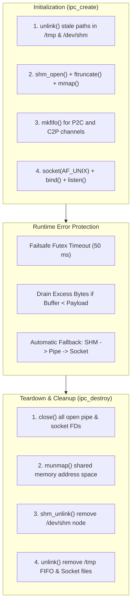

# Architecture Specification: Error Handling & Resource Cleanup

## 1. The Realities of Linux Systems Programming

When building low-level systems in C on Linux, resource lifecycle management is critical:
- **Shared Memory Persists Beyond Process Death:** Unlike regular heap memory allocated via `malloc()`, POSIX shared memory allocated via `shm_open()` is managed by the Linux kernel inside `/dev/shm`. If a program crashes without calling `shm_unlink()`, the shared memory segment remains locked in RAM indefinitely, creating a memory leak at the operating system level.
- **Named FIFOs & Sockets Persist on the Filesystem:** Named FIFOs created with `mkfifo()` and UNIX domain sockets bound to filesystem paths remain in `/tmp` until unlinked. If a new process starts and attempts to bind to an uncleaned path, it receives `EADDRINUSE` or `EEXIST`.
- **Concurrency & Deadlocks:** If a Producer process crashes while the Consumer is asleep in a `SYS_futex` system call, the Consumer could hang forever unless explicit failsafe timeouts are enforced.

A-IPC implements rigorous error handling, resource cleanup, and crash protection across every subsystem.

---

## 2. Resource Lifecycle Management



---

## 3. Graceful Fallbacks & Runtime Fault Tolerance

### 1. Transport Fallback on Failure
In [src/aipc_channel.c](file:///src/aipc_channel.c#L216-L266), `ipc_send()` does not simply crash if a transport encounters an unexpected error:
- If the fast-path shared memory ring is unavailable or disabled, execution immediately falls through to the Pipe transport.
- If the Pipe fails or the pipe buffer is broken (`EPIPE`), execution falls through to the UNIX Domain Socket.
- Only if all three transports fail does `ipc_send()` return an error code (`-1`), allowing the calling application to handle the condition cleanly.

### 2. Receiver Buffer Truncation & Draining
If an application calls `ipc_receive(chan, buf, max_len)` with a buffer smaller than the incoming message payload (`len > max_len`):
- A-IPC copies exactly `max_len` bytes into the user's buffer.
- For stream transports (Pipes and Sockets), leaving unread payload bytes in the stream would corrupt subsequent frame headers!
- A-IPC invokes `drain_bytes(fd, remaining_bytes)` in [src/aipc_channel.c](file:///src/aipc_channel.c#L66-L73) to consume and discard the unread tail, guaranteeing that subsequent frames maintain exact header alignment.

### 3. Futex Deadlock Prevention (Failsafe 50ms Timeout)
In [src/aipc_fas_ring.c](file:///src/aipc_fas_ring.c#L156-L157):

```c
// Failsafe 50ms timeout prevents permanent deadlock if scheduler preempts across core boundary
struct timespec ts = {.tv_sec = 0, .tv_nsec = 50000000};
fas_futex_wait(&ring->futex_word, (int)expected_futex, &ts);
```
If a Producer is terminated, suspended by `SIGSTOP`, or preempted by the Linux scheduler, the Consumer will never hang indefinitely. Every 50 milliseconds, the futex wakes up, checks channel health, and re-evaluates the state.

---

## 4. Teardown Architecture: `ipc_close()` vs. `ipc_destroy()`

A-IPC separates local disconnection from global destruction:

### `ipc_close(ipc_channel_t *chan)`
Located in [src/aipc_channel.c](file:///src/aipc_channel.c#L389-L417):
- Closes the process's local file descriptors (`pipe_tx_fd`, `pipe_rx_fd`, `sock_fd`, `sock_listen_fd`).
- Unmaps the shared memory segment from this process's virtual address space via `munmap()`.
- Does **not** unlink shared nodes from the operating system, allowing peer processes to finish reading pending messages.

### `ipc_destroy(ipc_channel_t *chan)`
Located in [src/aipc_channel.c](file:///src/aipc_channel.c#L419-L430):
- Calls `ipc_close()` to unmap and close local handles.
- If the calling process was the creator (`chan->is_creator == true`):
  - Calls `shm_unlink("/aipc_<name>_shm")` to free physical RAM in `/dev/shm`.
  - Calls `unlink("/tmp/aipc_<name>_p2c.fifo")` and `unlink("/tmp/aipc_<name>_c2p.fifo")`.
  - Calls `unlink("/tmp/aipc_<name>_sock")`.
- Guarantees zero residual clutter on the filesystem or operating system.
