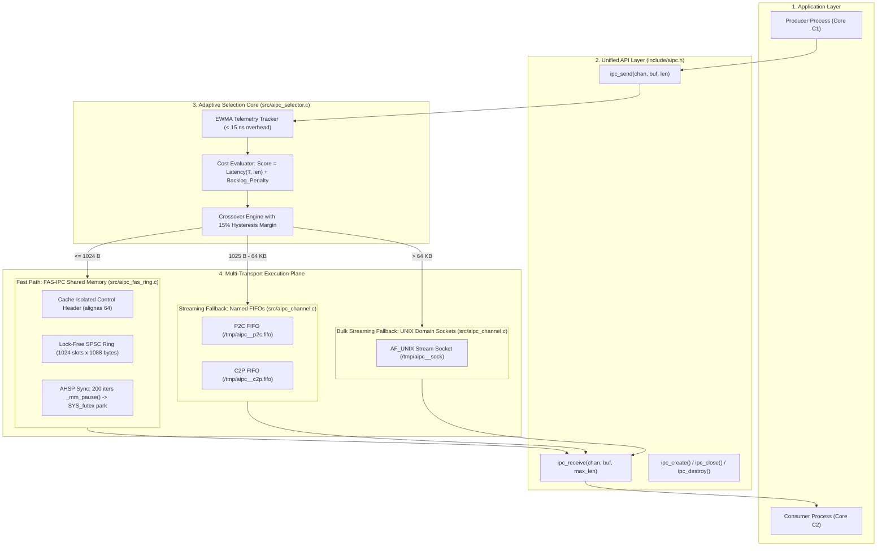

# Architecture Specification: System Architecture

## 1. Architectural Overview

The **Adaptive Inter-Process Communication (A-IPC)** framework is architected as an intelligent user-space abstraction layer that decouples application code from the low-level complexities of Linux kernel IPC primitives.

The system is organized into four distinct structural layers:
1. **Application Layer:** Two communicating processes (e.g., Producer and Consumer) pinned to isolated CPU cores.
2. **Unified API Layer:** A clean, minimal C11 interface (`ipc_create()`, `ipc_send()`, `ipc_receive()`, `ipc_close()`, `ipc_destroy()`).
3. **Adaptive Selection Core:** Real-time EWMA traffic observer, cost evaluator, and hysteresis dampener.
4. **Multi-Transport Execution Plane:** Hardware-sympathetic shared memory ring buffer (FAS-IPC) paired with Linux Pipes and UNIX Domain Sockets.



---

## 2. Component Specifications

### 1. The Unified Channel Handle (`ipc_channel_t`)
Located in [include/aipc.h](file:///include/aipc.h#L46-L76), this is the master context object allocated per channel endpoint:
- **`channel_name`**: Human-readable string identifier used to namespace shared memory segments and filesystem nodes.
- **`role`**: `IPC_ROLE_PRODUCER` (creator of resources) or `IPC_ROLE_CONSUMER` (attaches to resources).
- **`is_creator`**: Boolean flag indicating ownership for unlinking on teardown.
- **`current_transport`**: Currently active transport enum (`IPC_TRANSPORT_FAS_SHM`, `IPC_TRANSPORT_PIPE`, `IPC_TRANSPORT_SOCKET`).
- **`selector`**: Embedded `aipc_selector_t` state tracking EWMA statistics.
- **`fas_chan`**: Duplex handle to the shared memory ring buffer.
- **`pipe_tx_fd` / `pipe_rx_fd`**: File descriptors for bi-directional FIFO streaming.
- **`sock_fd` / `sock_listen_fd`**: UNIX domain stream socket file descriptors.
- **`tx_seq` / `rx_seq`**: Monotonic 64-bit sequence counters ensuring strict global ordering.

---

### 2. Binary Framing Header (`aipc_frame_hdr_t`)
Located in [include/aipc.h](file:///include/aipc.h#L35-L41):

```c
#define AIPC_FRAME_MAGIC 0xA1PC0001U

typedef struct __attribute__((packed)) {
    uint32_t magic;         // Validation magic word (0xA1PC0001)
    uint32_t payload_len;   // Payload length in bytes
    uint64_t seq_num;       // Sequential message index
    uint32_t transport_id;  // Source transport identifier
    uint32_t checksum;      // XOR integrity checksum
} aipc_frame_hdr_t;
```
- **Size:** Exactly 24 bytes (`__attribute__((packed))` prevents compiler padding).
- **Function:** Prepended to every message transmitted over Pipes or UNIX Sockets to preserve message boundaries and provide sequence alignment.

---

### 3. FAS-IPC SPSC Cache-Isolated Ring Buffer (`fas_ring_t`)
Located in [include/aipc_fas_ring.h](file:///include/aipc_fas_ring.h#L46-L96):

```c
typedef struct {
    // Cache Line 0 (Producer Core C1): Offset 0..63
    alignas(64) atomic_uint_least32_t tail;
    uint32_t cached_head;
    uint8_t  pad0[64 - sizeof(atomic_uint_least32_t) - sizeof(uint32_t)];

    // Cache Line 1 (Consumer Core C2): Offset 64..127
    alignas(64) atomic_uint_least32_t head;
    uint32_t cached_tail;
    uint8_t  pad1[64 - sizeof(atomic_uint_least32_t) - sizeof(uint32_t)];

    // Cache Line 2 (Synchronization & Futex): Offset 128..191
    alignas(64) atomic_uint_least32_t futex_word;
    atomic_uint_least32_t waiting_readers;
    uint8_t  pad2[64 - (2 * sizeof(atomic_uint_least32_t))];
} fas_control_header_t;

typedef struct fas_ring {
    union {
        fas_control_header_t ctrl;
    };
    alignas(64) fas_slot_t slots[1024];
} fas_ring_t;
```

#### Micro-Architectural Memory Map:
```text
Offset (Bytes)   Structure Member       Cache Line   Primary Accessing Core
--------------------------------------------------------------------------------
0000 - 0063      tail, cached_head      Line 0       Core C1 (Producer ONLY)
0064 - 0127      head, cached_tail      Line 1       Core C2 (Consumer ONLY)
0128 - 0191      futex_word, waiters    Line 2       Coordination (Futex)
0192 - 1279      Slot 0 (1088 bytes)    Lines 3..19  Data Payload
1280 - 2367      Slot 1 (1088 bytes)    Lines 20..36 Data Payload
...              ...                    ...          ...
```

---

## 3. Public API Specification

1. **`int ipc_create(ipc_channel_t *chan, const char *name, ipc_role_t role);`**  
   Allocates memory, maps shared memory via `shm_open()` and `mmap()`, creates FIFOs via `mkfifo()`, establishes the UNIX domain socket connection, and initializes telemetry. Returns `0` on success, negative error code on failure.

2. **`int ipc_send(ipc_channel_t *chan, const void *buf, size_t len);`**  
   Records traffic telemetry, evaluates transport cost, selects the winning transport, assigns a monotonic 64-bit sequence number, and executes the transmission.

3. **`int ipc_receive(ipc_channel_t *chan, void *buf, size_t max_len);`**  
   Coordinates multi-transport demuxing: checks the fast-path shared memory ring first, drains pending stream frames from FIFOs and Sockets, and guarantees that messages are received in exact chronological sequence.

4. **`int ipc_close(ipc_channel_t *chan);`**  
   Closes all local descriptors and unmaps the shared memory segment.

5. **`int ipc_destroy(ipc_channel_t *chan);`**  
   Unlinks all shared memory segments and filesystem nodes from the OS.
