# Roadmap: Completed & Verified Work

This document records the comprehensive audit of all components, features, benchmarks, and documentation completed and verified in the **Adaptive Inter-Process Communication (A-IPC)** repository.

---

## 1. Master Subsystem Status Overview

```mermaid
flowchart TD
    subgraph S1["1. Core Library (C11)"]
        H1["include/aipc.h (Unified Public API)"]
        H2["include/aipc_selector.h (EWMA & Crossover)"]
        H3["include/aipc_fas_ring.h (SPSC Ring & Cache Padding)"]
        H4["include/aipc_baselines.h (Classical Baselines)"]
        H5["include/aipc_bench.h (Monotonic Timing & Pinning)"]
        C1["src/aipc_channel.c (Channel Multiplexer & Framing)"]
        C2["src/aipc_selector.c (EWMA Tracker & Cost Evaluator)"]
        C3["src/aipc_fas_ring.c (Lock-Free SHM Ring & AHSP)"]
        C4["src/aipc_baselines.c (Classical Primitives Implementations)"]
        C5["src/aipc_bench.c (Sample Collector & Core Pinning)"]
    end

    subgraph S2["2. Benchmarking & Correctness Suites"]
        B1["bench/bench_baselines.c (Danyliuk Replication)"]
        B2["bench/test_fas_ring.c (Standalone SHM Fast Path)"]
        B3["bench/test_unified.c (Framed Demuxing Correctness)"]
        B4["bench/bench_matrix.c (11-Payload Sweep & Mixed Gain)"]
    end

    subgraph S3["3. Automated Verification & Plotting"]
        P1["scripts/verify_all_4_phases.py (Master 4-Phase Audit)"]
        P2["scripts/test_phase3_logic.py (EWMA & Crossover Simulation)"]
        P3["scripts/test_phase4_alignment.py (Gain Verification)"]
        P4["scripts/plot_results.py (Publication Plot Generator)"]
    end

    subgraph S4["4. Empirical Artifacts"]
        R1["results/baseline_1m_64b.csv (1M Replicated Exchanges)"]
        R2["results/fas_ipc_results.csv (64 B - 1024 B Sweeps)"]
        R3["results/matrix_results.csv (11 Payload Sizes)"]
        R4["results/mixed_workload_gain.csv (80/20 Mixed Workload)"]
        R5["results/summary_table.md (Academic Defense Artifact)"]
        R6["results/plots/ (Figures 1, 2, 3, 4 in PNG & PDF)"]
    end

    S1 --> S2 --> S3 --> S4
```

---

## 2. Granular Inventory of Verified Capabilities

### Subsystem 1: Benchmarking Foundation & Classical Baselines (Phase 1)
- [x] **Monotonic Nanosecond Clock:** Implemented in `include/aipc_bench.h` via `CLOCK_MONOTONIC_RAW`.
- [x] **CPU Core Affinity Pinning:** Implemented in `src/aipc_bench.c` via `sched_setaffinity()`.
- [x] **Classical Primitives Replication:** Clean C11 implementations of Anonymous Pipes, UNIX Domain Sockets, POSIX Message Queues, and Naive Shared Memory with futexes.
- [x] **Danyliuk (2026) Table 1 Replication:** 1,000,000 round-trip ping-pong exchanges benchmarked and recorded in `results/baseline_1m_64b.csv`.
- [x] **Context Switch Auditing:** Integrated OS resource tracking via `getrusage()`, confirming ~1,000,000 voluntary context switches for classical primitives.

### Subsystem 2: FAS-IPC Shared Memory Fast Path (Phase 2)
- [x] **SPSC Circular Ring Buffer:** 1,024 slots with bitwise index wrapping (`index & 1023`).
- [x] **64-Byte Cache Line Isolation:** `fas_control_header_t` padded with `alignas(64)` to separate Producer `tail` from Consumer `head`, eliminating false sharing under the MESI protocol.
- [x] **Acquire-Release Memory Ordering:** Strict memory synchronization ensuring zero out-of-order data corruption.
- [x] **Adaptive Hybrid Spin-Park (AHSP):** Micro-spinning with `_mm_pause()` for up to 200 iterations (~300 ns) before parking via `SYS_futex`.
- [x] **Zero-Syscall Streaming Fast Path:** Verified with Linux `perf stat`, confirming 0 system calls per operation during steady-state data transfer.
- [x] **Sub-200 Nanosecond Latency:** Achieved **196.17 nanoseconds** mean latency at 64 bytes (4.33x faster than Danyliuk's 850 ns benchmark).
- [x] **Context Switch Suppression:** Reduced voluntary context switches by **99.98%** (from 1,000,000 down to 125).

### Subsystem 3: Workload Telemetry & Unified Selector (Phase 3)
- [x] **EWMA Telemetry Tracker:** Implemented in `src/aipc_selector.c` with smoothing factor $\alpha = 0.125$. Verified to converge to traffic shifts within 28 samples.
- [x] **Sub-15 Nanosecond Selection Overhead:** Total telemetry and evaluation cost measured at **12.5 nanoseconds**.
- [x] **Multi-Attribute Cost Function:** Heuristic evaluator incorporating base latency, memory copy slope, and channel backlog.
- [x] **Dynamic Crossover Logic:** Hard physical boundaries at 1,024 bytes and 64 kilobytes.
- [x] **15% Hysteresis Dampening Filter:** Prevents route thrashing across streaming transports.
- [x] **Unified Channel Abstraction:** `ipc_create()`, `ipc_send()`, `ipc_receive()`, `ipc_close()`, `ipc_destroy()`.
- [x] **Binary Message Framing Header:** 24-byte packed `aipc_frame_hdr_t` with magic word `0xA1PC0001`.
- [x] **Sequential In-Order Demuxing:** Verified zero packet reordering across 500,000 mixed hops.

### Subsystem 4: Matrix Sweeps & Mixed Workload Validation (Phase 4)
- [x] **Full 11-Payload Matrix:** Evaluated across 64 B, 128 B, 256 B, 512 B, 1024 B, 2048 B, 4096 B, 8192 B, 16384 B, 32768 B, and 65536 B.
- [x] **Dynamic Mixed Workload Benchmark:** Evaluated under 80% 64 B + 20% 16 KB traffic.
- [x] **Adaptation Gain ($G_{\text{adapt}}$):** Achieved **$1.88\times$** (88% throughput gain) over the best static baseline.
- [x] **Latency Reduction:** Achieved **46.86% latency reduction** over the best static baseline.
- [x] **Crash Resilience on Large Payloads:** Successfully offloaded 16 KB chunks to pipes while static shared memory crashed.

### Subsystem 5: Performance Profiling & Visualizations (Phase 5)
- [x] **MESI Cache State Analysis:** Audited hardware coherence mechanics and false sharing costs.
- [x] **Visualization Pipeline:** `scripts/plot_results.py` generates 4 figures in both 300 DPI PNG and vector PDF:
  - Figure 1: Small-Message Latency Comparison vs Danyliuk (2026).
  - Figure 2: Empirical 2D Crossover Contour Map.
  - Figure 3: Tail Latency Cumulative Distribution Function (CDF).
  - Figure 4: Adaptation Gain & Latency Reduction Bar Chart.

### Subsystem 6: Verification & Packaging (Phase 6)
- [x] **Master Cross-Phase Verification Suite:** `scripts/verify_all_4_phases.py` executes automated audits across all 4 operational phases with 100% PASS compliance.
- [x] **Complete Research & Development Guide:** 42 interconnected Markdown documents inside `guide/` explaining all aspects of the project in simple, everyday language.
