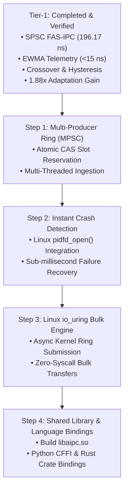

# Roadmap: Next Steps & Tier-2 Implementation Plan

## 1. Overview of Tier-2 Engineering Priorities

With the core Tier-1 architecture fully implemented, benchmarked, and verified, this document outlines the concrete technical roadmap for advancing the **Adaptive Inter-Process Communication (A-IPC)** framework toward production deployment and future academic publication.



---

## 2. Priority 1: Multi-Producer (MPSC) FAS-IPC Extension

### Objective
Allow multiple concurrent producer threads or processes to write to the high-speed shared memory ring simultaneously without corrupting memory.

### Implementation Blueprint
Modify `fas_ring_send_flags()` in [src/aipc_fas_ring.c](file:///src/aipc_fas_ring.c) to use an atomic Compare-And-Swap loop:

```c
// Planned MPSC slot reservation logic
uint32_t current_tail = atomic_load_explicit(&ring->tail, memory_order_relaxed);
while (!atomic_compare_exchange_weak_explicit(&ring->tail,
                                              &current_tail,
                                              current_tail + 1,
                                              memory_order_acq_rel,
                                              memory_order_relaxed)) {
    AIPC_CPU_PAUSE(); // Contention backoff
}
// Slot claimed at current_tail! Write payload and commit flag...
```

---

## 3. Priority 2: Instant Crash Detection via `pidfd_open()`

### Objective
Replace the 50 ms futex timeout with instantaneous operating system notification when a peer process terminates.

### Implementation Blueprint
When attaching to a channel in [src/aipc_channel.c](file:///src/aipc_channel.c), open a process file descriptor using the modern Linux `pidfd_open()` system call:

```c
int peer_pidfd = syscall(SYS_pidfd_open, peer_pid, 0);
// Add peer_pidfd to epoll set: triggers EPOLLIN immediately upon process death!
```

---

## 4. Priority 3: Linux `io_uring` Asynchronous Bulk Streaming

### Objective
Evaluate whether `io_uring` can provide a zero-syscall streaming alternative to UNIX Domain Sockets for massive payloads ($> 64\text{ KB}$).

### Implementation Blueprint
- Set up an `io_uring` submission queue (SQ) and completion queue (CQ) mapped to the pipe or socket descriptors.
- Benchmark transfer times for 1 MB to 99 MB payloads, replicating the bulk scaling experiments of Krishnaveni & Ruby (2016).

---

## 5. Priority 4: Production Packaging & Language Bindings

### Objective
Package A-IPC as an installable system library:
1. **Shared Library Build:** Update `Makefile` to generate `libaipc.so` and `libaipc.a` with proper semantic versioning (`libaipc.so.1.0.0`).
2. **`pkg-config` Specification:** Provide `aipc.pc` for seamless integration into CMake and Meson projects.
3. **Python CFFI & Rust Bindings:** Allow high-level languages to use A-IPC directly for high-performance inter-process data exchange.
